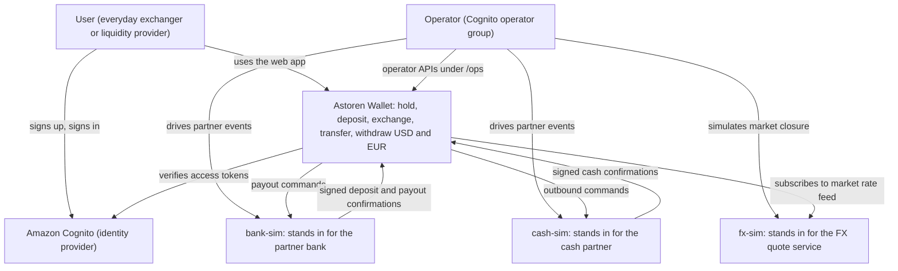

# astoren-wallet

> **Practice project.** This is a learning exercise, not a financial product. It holds no real money, is not licensed or regulated, and its partner integrations are local simulators. Do not deploy it to handle real funds.

A USD/EUR exchange wallet pilot. Users hold both currencies and exchange them at a house quote or by taking a better P2P offer. Money moves in and out through a partner bank or cash partner, and every partner is a local simulator. Product framing: [PRD §1][prd-vision]. The code is a pnpm + Turborepo monorepo whose layout and versions follow the [architecture spine][spine].

## Source of truth

The planning docs are authoritative; this README only routes you to them.

| Question | Document |
|---|---|
| What and why | [PRD][prd] · [addendum][prd-addendum] (technical mechanism) |
| Rules the code follows | [Architecture spine][spine] (AD-n decisions) |
| How it fits together | [C4 model][c4] · [ADRs][adrs] (reader's guides to the spine) |
| Look and behaviour | [DESIGN][ux-design] · [EXPERIENCE][ux-experience] · [mockups][ux-mockups] (HTML, open locally) |
| Plan and stories | [Epics][epics] · story specs in [implementation-artifacts][impl] and [specs][specs] |

[prd]: _bmad-output/planning-artifacts/prds/prd-astoren-wallet-2026-11-04/prd.md
[prd-vision]: _bmad-output/planning-artifacts/prds/prd-astoren-wallet-2026-11-04/prd.md#1-vision
[prd-addendum]: _bmad-output/planning-artifacts/prds/prd-astoren-wallet-2026-11-04/addendum.md
[spine]: _bmad-output/planning-artifacts/architecture/architecture-astoren-wallet-2026-11-08/ARCHITECTURE-SPINE.md
[c4]: _bmad-output/planning-artifacts/architecture/architecture-astoren-wallet-2026-11-08/companions/c4.md
[adrs]: _bmad-output/planning-artifacts/architecture/architecture-astoren-wallet-2026-11-08/companions/README.md
[ux-design]: _bmad-output/planning-artifacts/ux-designs/ux-astoren-wallet-2026-11-08/DESIGN.md
[ux-experience]: _bmad-output/planning-artifacts/ux-designs/ux-astoren-wallet-2026-11-08/EXPERIENCE.md
[ux-mockups]: _bmad-output/planning-artifacts/ux-designs/ux-astoren-wallet-2026-11-08/mockups/
[epics]: _bmad-output/planning-artifacts/epics.md
[impl]: _bmad-output/implementation-artifacts/
[specs]: _bmad-output/specs/

## System context

Who uses the wallet and which outside systems it depends on. The three `*-sim` services are built here but play outside parties, so the wallet reaches them only through partner-style interfaces (AD-1, AD-4). Containers, components and deployment are in the [C4 model][c4].

<!-- Copied from the C4 model, Level 1 (companions/c4.md). Edit there first, then sync here. -->


## Requirements

- **Node 26 LTS** (`.nvmrc`). `engines.node` is `>=26` and `.npmrc` sets `engine-strict=true`, so `pnpm install` fails on an older Node. Run `nvm use` first.
- **pnpm 10**, pinned through `packageManager`. Node 25+ no longer bundles corepack, so install it once per Node version: `npm install -g corepack && corepack enable` (or `npm install -g pnpm@10.33.0`).

## One command

```sh
pnpm install && pnpm turbo build lint test
```

The root scripts `pnpm build`, `pnpm lint` and `pnpm test` run the same Turborepo tasks.

## Toolchain standards

- **Tests:** Vitest in every workspace and in `tooling/` (`pnpm test:tooling`). Tests live in `<workspace>/test/` as `*.test.ts(x)`.
- **Format:** one root `.prettierrc` (double quotes, trailing commas, semicolons); Markdown is not formatted. `pnpm format` rewrites, and `turbo lint` runs `prettier --check .` as `//#format:check`.
- **Lint:** type-aware `typescript-eslint` (`recommendedTypeChecked`), so a forgotten `await` fails `no-floating-promises`. `turbo lint` also type-checks and lints `tooling/` (`//#lint:tooling`).
- **Pre-commit:** husky + lint-staged run `eslint --fix` and `prettier --write` on staged files only. The hook loads nvm when present. The full suite stays in the one command above.
- **Hook usage:** hooks install on `pnpm install` (the `prepare` script). The hook re-stages the files it formats. Skip it with `git commit --no-verify` or `HUSKY=0`.

## Layout

| Path | What |
|---|---|
| `apps/wallet-api` | NestJS 12. `src/main.ts` (api) and `src/worker.ts` (worker) share one codebase; `src/<module>/` holds the ten AD-3 modules. |
| `apps/web` | Vite 8 + React 19 + React Router 8 + TanStack Query 5 + Tailwind 4 + shadcn/ui + lucide-react. |
| `simulators/*` | `bank-sim`, `cash-sim`, `fx-sim`, `mock-jwt-issuer`. Isolated NestJS stubs: they import nothing outside their own folder. |
| `packages/contracts` | `@astoren/contracts`: zod v4 schemas. |
| `packages/money` | `@astoren/money`: decimal.js based money helpers. |
| `docs/` | Decision notes (`openapi-from-zod.md`) and `partner-specs/`. |
| `infra/` | Terraform, Helm and deploy scripts (placeholders for now). |
| `tooling/` | Root checks (Vitest): `boundaries/` (lint boundary fixtures), `tests-layout/` and `toolchain/` (Node 26 pin). |

## Module boundaries

`eslint.config.js` (root, shared by every workspace) encodes the wallet-api module graph and simulator isolation with eslint-plugin-boundaries. Cross-module imports may only target `*.service.ts`, `*.module.ts` and `*.types.ts`. `tooling/boundaries/boundaries.test.ts` lints committed probe files and asserts which imports are rejected. It runs as part of `pnpm turbo test` (`pnpm test:tooling` on its own).

## Default ports

| Runnable | Port |
|---|---|
| wallet-api (api) | 3000 |
| bank-sim | 3101 |
| cash-sim | 3102 |
| fx-sim | 3103 |
| mock-jwt-issuer | 3104 |

Override any of them with `PORT`.

## Running locally

```sh
pnpm --filter wallet-api start           # api on :3000, OpenAPI JSON at /docs-json
node apps/wallet-api/dist/worker.js      # worker application context (runs until SIGTERM)
pnpm --filter web dev
```

## License

MIT, see [`LICENSE`](LICENSE).

Third-party: `_bmad/` and `.claude/skills/bmad-*` are generated by the [BMad Method](https://github.com/bmad-code-org/BMAD-METHOD) installer (v6.12.4, MIT) and stay under their own license. They are committed so the planning workflow is reproducible; do not edit them by hand.
