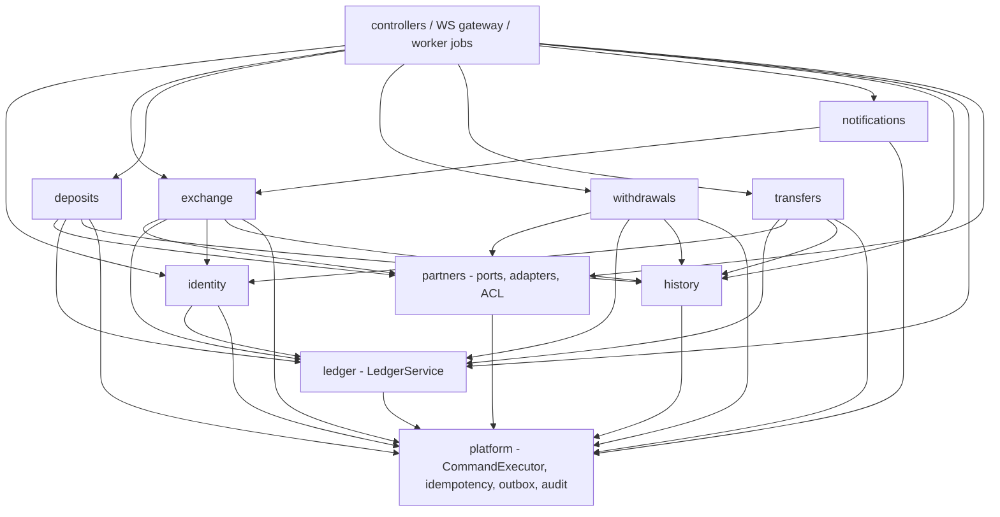
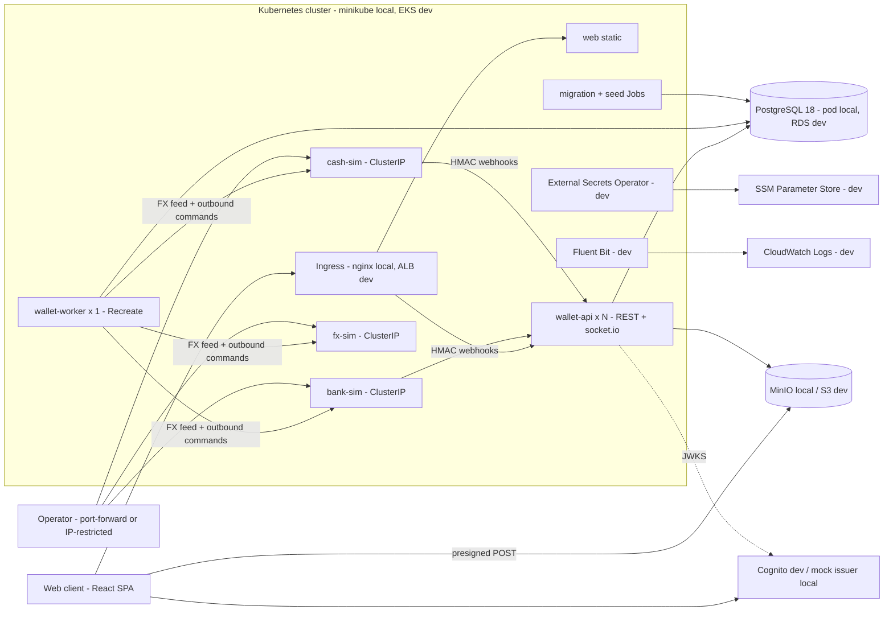
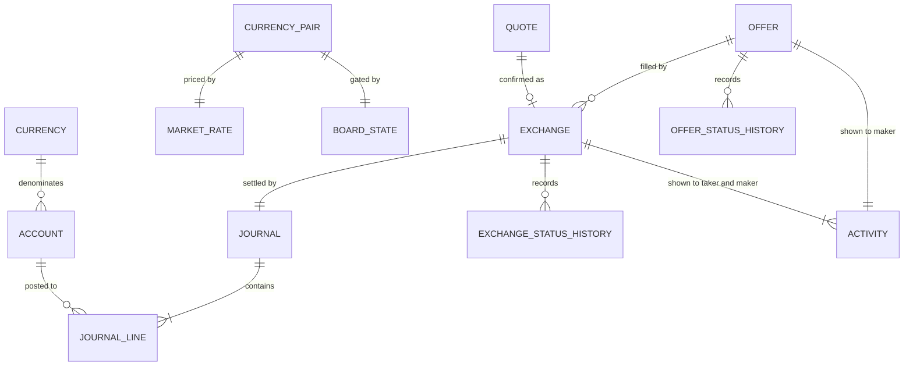
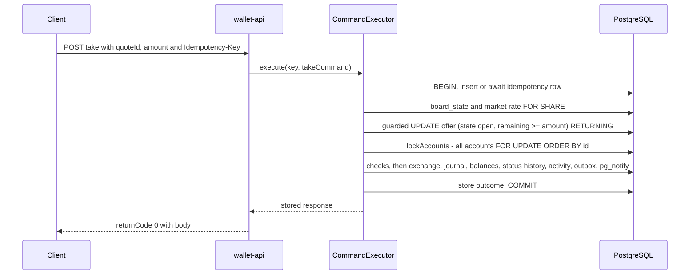

# Architecture Spine — Astoren Wallet

## Design Paradigm

**Layered modular monolith.** `wallet-api` and `wallet-worker` are two entry points of one NestJS codebase. Each module is layered `controller -> service -> repository` and owns one Postgres schema. **Hexagonal ports/adapters + anti-corruption layer (ACL) only at the partner edge** (`partners` module). Partner simulators are separate deployables speaking partner-style wire formats.

| Layer | Lives in | May contain |
| --- | --- | --- |
| Controller / gateway | `apps/wallet-api/src/<module>/*.controller.ts`, `*.gateway.ts` | HTTP/WS mapping, schema validation, envelope. No business rules. |
| Service | `apps/wallet-api/src/<module>/*.service.ts` | All business rules. The only thing other modules may call. |
| Repository | `apps/wallet-api/src/<module>/*.repository.ts` | TypeORM queries for the module's own schema only. |
| Ports / adapters | `apps/wallet-api/src/partners/` | `PartnerBankPort`, `CashPartnerPort`, `FxFeedPort`, simulator adapters, `PartnerEventHandler` dispatch interface. |
| Platform | `apps/wallet-api/src/platform/` | `CommandExecutor`, idempotency, outbox + consumer registry, audit, correlation. |



Arrows are the only allowed compile-time dependencies. `partners` never imports `deposits` or `withdrawals`: they implement its `PartnerEventHandler` interface and register with it (no `forwardRef`). `ledger` and `history` depend only on `platform`. Outbox consumers register with `platform`'s consumer registry; no money flow calls `notifications` synchronously.

## Invariants & Rules

### AD-1 — System shape: one wallet deployable, separate simulators, one monorepo [ADOPTED]

- **Binds:** all; NFR-7, FR-19, NFR-1
- **Prevents:** product logic leaking into simulators; partner-to-wallet backdoors; splitting atomic settlement across services.
- **Rule:** The wallet is one codebase with two runnables: `wallet-api` (N stateless instances, REST + WebSocket) and `wallet-worker` (exactly-one jobs). `bank-sim`, `cash-sim`, `fx-sim` are separate single-instance NestJS runnables, each with its own chart and pod, keeping state in memory (lost on restart). They are reached only through partner-facing interfaces and never import wallet code or types; shared formats are duplicated as specs. The wallet exposes no credit/backdoor endpoint. Everything lives in one pnpm + Turborepo monorepo.

### AD-2 — Module boundaries inside wallet-api [ADOPTED]

- **Binds:** all wallet-api modules
- **Prevents:** builders reaching into another module's tables or entities; drift that makes a later hexagonal refactor expensive.
- **Rule:** Business rules only in services, never in controllers or repositories. Cross-module access only through the owning module's exported service, following the dependency diagram above. TypeORM entities and repositories never leave their module. eslint-plugin-boundaries fails the build on a violation.

### AD-3 — Schema-per-module ownership, one database [ADOPTED]

- **Binds:** all persisted data; FR-19
- **Prevents:** two owners of one table; cross-schema writes that bypass the owner's rules.
- **Rule:** One PostgreSQL database, one schema per module. A module writes only its own schema. Ledger tables are written only by `LedgerService`. Each module owns the business parameters it uses (AD-28) and its own `<entity>_status_history` tables (AD-17). Table names keep PRD terms.

| Module | Owns |
| --- | --- |
| identity | users (email unique, display name), Cognito `sub` -> `user_id` |
| ledger | currencies, accounts, journals, journal lines, balance projection |
| exchange | currency pairs, market rate rows, `board_state`, house quote parameters, quotes, offers, exchanges |
| deposits | deposit requests, receipt metadata, unmatched + unattributable funds, deposit limits |
| withdrawals | bank payouts, saved payout accounts, withdrawal limits |
| transfers | transfers, transfer limits |
| notifications | in-app notifications, price alerts |
| history | per-user activity projection (AD-30) |
| partners | partner-event inbox, adapter state |
| platform | idempotency keys, outbox, consumed events, operator audit |

### AD-4 — Partner edge is an anti-corruption layer [ADOPTED]

- **Binds:** partners, deposits, withdrawals, exchange (FX feed); NFR-3, NFR-7, FR-6, FR-8, FR-12
- **Prevents:** two dedupe stores for partner events; simulator payload shapes leaking into domain code; network calls holding row locks; wire formats drifting between simulator and adapter.
- **Rule:** Only `partners` speaks to partners. Each simulator owns its wire spec in `docs/partner-specs/{bank,cash,fx}.md` (webhook payloads, FX feed messages with `rate`, `sequence`, `session`, `ts`); adapters conform to it. Signing both ways: HMAC-SHA256 over `timestamp + "." + rawBody`, with `X-Signature` / `X-Timestamp` headers and a timestamp window (AD-28). Partner routes are exempt from the user JWT guard and the AD-21 envelope. **The inbox row is the only dedupe record for partner events:** `partners` opens the `CommandExecutor` transaction with identity `partner_event_id`, inserts the inbox row (conflict -> replay stored outcome), translates, calls the registered `PartnerEventHandler` with `tx`, records the outcome on the inbox row, commits, then acknowledges. Handlers never open their own command. **Outbound partner calls never run inside a transaction:** the transaction writes an outbox command; the worker calls the port after commit with the business id as the partner idempotency key. Going live changes only `partners` adapters and config.

### AD-5 — Ledger entries are the source of truth [ADOPTED]

- **Binds:** ledger and every money-moving flow; NFR-1, NFR-5, SM-2, FR-2
- **Prevents:** a balance changing without a ledger record, or the reverse; two journals for one operation; builders inventing journal types and account pairs.
- **Rule:** Three tiers in one transaction: (1) business record + status history, (2) exactly one `journal` per `(type, business_ref)` (unique) with `journal_line`s (account, signed amount, `balance_after`), lines per currency summing to zero, append-only, (3) balance projection. `JournalType` is a closed enum in `ledger` declaring each type's account roles: `seed`, `deposit_credit` (house cash at partner bank -> user available), `withdrawal_hold` (available -> pending), `withdrawal_settle` (pending -> house cash at partner bank), `offer_hold`, `offer_release`, `exchange`, `transfer`; multi-stage flows use one type per stage; adding a type is a ledger change. `pending` is used only by withdrawals. User-facing history reads `history` (AD-30), never journal lines. Projection vs journal drift is a reconciliation failure (SM-2).

### AD-6 — Account model [ADOPTED]

- **Binds:** ledger, all modules posting to it; FR-2, FR-16, FR-21
- **Prevents:** a second balance mechanism for house/system positions; negative user balances; user APIs exposing house accounts; unbalanced seeding.
- **Rule:** One `account` row per (owner_type, owner_id, currency, bucket); `owner_type` is `user | house | system`. Users have `available`, `held`, `pending` per supported currency, with a DB `CHECK (balance >= 0)` on user accounts. House/system accounts (treasury per currency, cash at partner bank, cash-partner settlement payable, unmatched funds, unattributable funds, rounding/fee revenue, opening equity per currency) live in the same table and may run negative where their nature requires. User APIs never expose house/system rows; `exchange` may expose only a derived per-direction `houseMaxFill` and `houseAvailable`.

### AD-7 — Money and rate representation [ADOPTED]

- **Binds:** all code, DB and API touching amounts or rates; NFR-1
- **Prevents:** float drift; divergent rounding sites; ad hoc amount shapes; hardcoded currency lists.
- **Rule:** Currencies are data (ISO 4217 code + minor-unit exponent) in `ledger.currencies`. Amounts are integer minor units: Postgres `bigint`, TypeScript `bigint` in the backend, JSON `{ "amountMinor": <integer>, "currency": "<ISO code>" }`, validated against the supported set. Rates and margins are Postgres `numeric(18,8)`, `decimal.js` in TypeScript, decimal strings in JSON. JS `number` arithmetic on money, rates or margins is forbidden. `packages/money` owns `convert()` (the only place a conversion rounds), the comparator for "better for taker", the shared column transformers, and the client format/parse helpers.

### AD-8 — Rounding favours the house [ADOPTED]

- **Binds:** `convert()`, exchange settlement, P2P takes; NFR-1, SM-1
- **Prevents:** unbalanced per-currency journals; per-builder rounding choices.
- **Rule:** In every conversion the payer side rounds up and the receiver side rounds down to whole minor units. Any difference (0 or 1 minor unit) is credited to the house rounding/fee revenue account in the same journal, including on P2P takes.

### AD-9 — Currency pairs and the single price convention [ADOPTED]

- **Binds:** exchange, contracts, web client; FR-12, FR-13, FR-18, FR-21, FR-22, SM-1
- **Prevents:** two builders inverting rates or applying spreads and margins in opposite directions; a design that only works for two currencies.
- **Rule:** Each supported currency pair has one canonical direction (base/quote) and one market rate row; every stored and transmitted price is **quote currency per 1 base**. The pilot has one pair, EUR/USD (USD per 1 EUR). An offer stores its source currency (what the maker gives), target currency (what the maker gets) and price in the pair's canonical unit. House price per side is computed from the market rate so the taker receives `(1 - (spread + addOn))` of market value, where `addOn` is the weekend add-on while the session is closed and 0 otherwise. "Better for taker" and the FR-21 worse-than-house check use the `packages/money` comparator. No inverted rate is ever stored; the client may display the inverse for presentation only. Code, DB and API say `market rate` (`market_rate`, `market_rate_at`), never `mid`; side/bid/ask never appear in the UI.

### AD-10 — Offers, derived flags and exchange snapshot [ADOPTED]

- **Binds:** exchange; FR-17, FR-19, FR-21, FR-22, SM-1, SM-3
- **Prevents:** stale persisted pegged prices; margin sign inverted by side; status history on every tick; comparing amounts in different currencies; the board computed differently in two places; exchanges that cannot be audited against the house ceiling.
- **Rule:** An offer's `amount` and `remaining` are in its source currency; a take's `amount` is always in the offer's source currency (house takes: the currency the house pays out), and any other currency is refused with a 1xx code. Minimum take, minimum offer and `closed_below_minimum` are evaluated in that currency; the taker's payment is `convert()`ed from it. Fixed offers store their price. Pegged offers store only a signed decimal-string margin fraction against the canonical price (e.g. `"-0.003"`); effective price = market rate x (1 + margin), computed per tick, never persisted; one `packages/money` helper converts a maker's entered "better for me %" to the canonical margin. Stored offer statuses are `open | filled | cancelled | closed_below_minimum`; *out of range* and *partially filled* are derived flags. `ExchangeService.computeBoard(pair, direction)` is the single function yielding effective prices, flags, ordering and the house line; the gateway and the alert evaluator both call it. Every exchange stores the price used, the market rate snapshot (`market_rate`, `market_rate_at`, feed sequence, session), and the spread, add-on or margin applied.

### AD-11 — Quote and exchange are separate entities [ADOPTED]

- **Binds:** exchange; FR-14, FR-15, FR-16, FR-18, FR-19, FR-20, FR-21
- **Prevents:** abandoned previews polluting history; mutating a financial record; stale quotes taking out-of-range offers.
- **Rule:** A `quote` is a disposable preview row (user, target offer or house, captured price, market rate snapshot, `expires_at`), written directly by its repository (no command, no idempotency key), prunable. House and pegged quotes expire after the lock window (AD-28); fixed-offer quotes carry no lock expiry. The response carries `expiresAt` and `lockSeconds`. An `exchange` is created once at confirm through `CommandExecutor` and references `quote_id`. Inside the transaction, after AD-14 locking, the take checks: quote owner; not expired; board live and `quote.created_at > paused_at`; session open implies market rate age <= max age; taker is not the maker; offer open with enough remaining; amount >= minimum take; price not worse than house — at the quote's snapshot for house and pegged quotes, at the current market rate for fixed-offer quotes; house liquidity (FR-16). It settles at the quote's price. If the remainder falls below the minimum offer size, the same guarded update sets `closed_below_minimum` and the same journal releases the maker's held remainder. Posting an offer applies the same board-state and freshness checks.

### AD-12 — CommandExecutor owns money and status transactions [ADOPTED]

- **Binds:** every write that moves money or changes a stored status; NFR-1, NFR-2, FR-19
- **Prevents:** money writes outside the business transaction; each use case inventing its own transaction and dedupe order.
- **Rule:** `CommandExecutor` is the only place such a transaction opens, in this order: resolve dedupe identity -> begin -> insert-or-await dedupe row (replay if an outcome exists) -> board/rate `FOR SHARE` when gated -> guarded transition of the business row -> `lockAccounts` -> checks -> effects (journal + lines, status history, history entry, outbox) -> record outcome -> commit. On Postgres deadlock (`40P01`) it retries the whole command once. It passes the transaction's `EntityManager` (`tx`) explicitly; every method that must run inside it takes `tx` as a required first parameter. No CLS / `@Transactional()`. Other single-row writes (quotes, saved payout accounts, alert creation, notification read flags) use the module repository in one statement and still stamp the correlation id.

### AD-13 — Races are settled by guarded transitions [ADOPTED]

- **Binds:** offers, exchanges, deposits, withdrawals, transfers; FR-6, FR-19, FR-20, FR-23
- **Prevents:** check-then-act races; blind overwrites of state rows; refusals without a reason.
- **Rule:** State changes are conditional updates: `UPDATE ... SET ..., version = version + 1 WHERE id = ? AND state IN (<expected>) AND <conditions> RETURNING ...`; 0 rows = refused, and nothing else in the transaction is touched. On 0 rows, re-read the row in the same transaction to choose the returnCode. FR-19 "arrival order" is the order Postgres grants the row lock. Example: deposit credit accepts `open` or `awaiting_confirmation` (the receipt is optional); receipt attach accepts `open` only. TypeORM `save()` is forbidden on money or state rows. No in-memory matching engine, no optimistic-version retries.

### AD-14 — Lock order [ADOPTED]

- **Binds:** every `CommandExecutor` transaction; FR-4, FR-11, FR-15, FR-16, FR-19, FR-21, FR-24
- **Prevents:** deadlocks between independently written use cases; write skew on limit checks; checks against unlocked state.
- **Rule:** Lock acquisition per transaction is fixed: (1) `board_state` and the pair's market rate row `FOR SHARE` when the command is gated by them, (2) the single business row via its guarded update, (3) the complete set of ledger accounts the command will check or post to, in one `LedgerService.lockAccounts(tx, ids)` call ordered by id, before any aggregate check. A limit or rate-limit check includes the user's `available` account in that currency in the set, even when no money moves. `post()` asserts its accounts are already locked and never acquires a new lock. No code issues `FOR UPDATE` on an account outside `lockAccounts`. House takes serialise on the house treasury rows; accepted for the pilot.

### AD-15 — Isolation levels [ADOPTED]

- **Binds:** all database access; SM-2
- **Prevents:** mixed isolation levels and ad hoc retry loops; false imbalance alarms.
- **Rule:** All write paths run at READ COMMITTED. Reconciliation, statements and reports run as `REPEATABLE READ READ ONLY`. No SERIALIZABLE.

### AD-16 — Idempotency semantics [ADOPTED]

- **Binds:** API edge, CommandExecutor, web client; NFR-2, FR-19
- **Prevents:** a duplicate moving money twice; a stale refusal replayed on a new attempt; duplicates racing past a check outside the transaction.
- **Rule:** The client mints an `Idempotency-Key` (UUID) when a confirm sheet opens and keeps it in `sessionStorage` while in flight. Quote refreshes keep it while it is unsent. The first send binds it to that exact body; double clicks, timeouts and reloads resend the same body + key and get the stored result replayed. A new key is minted only after a definitive refusal. While an outcome is unknown the body must not change; the client resends with backoff. `@Idempotent()` only marks the route and validates the key (missing or malformed -> HTTP 400). Dedupe happens inside `CommandExecutor`: table unique on `(user_id, key)` with `user_id NOT NULL`, request hash, status and stored response; same key + different body -> HTTP 422; refusals are stored outcomes; a concurrent duplicate waits on the unique index and replays; keys expire after about 24 h. This table is for client keys only (partner events use AD-4, outbox consumers AD-33). A 401 is decided before `CommandExecutor`, so the client refreshes the token and resends with the same key.

### AD-17 — Status history, events and open enums [ADOPTED]

- **Binds:** deposits, withdrawals, offers, exchanges, transfers, notifications; NFR-4, NFR-5, FR-3, FR-25
- **Prevents:** two audit mechanisms; status changes without history; events published for rolled-back work; later failure states breaking existing meaning.
- **Rule:** Each module owns `<entity>_status_history` tables in its schema with fixed columns `(id, <entity>_id, from_status, to_status, at, correlation_id, version)`, appended in the same transaction as the change and never updated or deleted. `platform.audit` records operator and back-office actions only. Every event other modules or clients must see is written to the outbox in that same transaction (AD-33). Status enums grow by adding values only; existing values never change meaning. Clients parse response and event enums leniently (unknown value -> neutral fallback); the API validates inbound payloads strictly.

### AD-18 — Market rate ingestion and real-time delivery [ADOPTED]

- **Binds:** wallet-worker, wallet-api WS gateway, exchange, web client; FR-12, FR-15, FR-17, FR-22, NFR-4
- **Prevents:** the UI reaching the FX service; the client's stale screen firing during a pause or closure; lost updates after reconnect; another user's events reaching a socket.
- **Rule:** Only `wallet-worker` subscribes to the FX feed; it upserts the pair's market rate row and `NOTIFY`s. Every `wallet-api` instance `LISTEN`s on one dedicated direct connection (never through a transaction-mode pooler), keeps the latest state in memory for pushes and previews only (never for decisions), and re-reads it after any reconnect. WebSockets use socket.io, websocket transport only. Rooms: `board:<pair>:<direction>` and one per authenticated user; clients never name a user room. The gateway pushes a full board snapshot (from `computeBoard`) per direction on every tick and on every offer event, with per-socket takeable flags, and at least every 3 s a `board.state` frame (`live | paused | closed`, server time). On every (re)connect the server sends a session snapshot (balances, board state, unread count) and the client invalidates its cached queries. Budget: commit to screen p95 < 500 ms. Ingress idle timeout exceeds twice the socket.io ping interval.

### AD-19 — wallet-worker is a singleton [ADOPTED]

- **Binds:** wallet-worker deployment; FR-15, FR-25, SM-2
- **Prevents:** two workers ingesting the feed, relaying the outbox or firing alerts at once.
- **Rule:** `wallet-worker` runs FX ingest, the board-state watchdog (AD-29), the outbox relay and in-process consumers (AD-33), price-alert evaluation (AD-32), the SM-2 reconciliation job (writes a structured result log line) and housekeeping (expired idempotency keys, old quotes), as a Deployment with `replicas: 1` and `strategy: Recreate`. Worker failure is fail-safe: ticks stop and the board pauses; user events are delayed until it returns and clients recover through the session snapshot.

### AD-20 — Authentication and user provisioning [ADOPTED]

- **Binds:** wallet-api REST + WebSocket, identity, web client; FR-1
- **Prevents:** an untested auth path locally; modules resolving users differently; users without accounts; provisioning races.
- **Rule:** Users authenticate with Amazon Cognito (one user pool in dev) through custom in-app forms using Amplify Auth v6, with email verification on. The web client talks to auth through one adapter selected by config; locally it targets a mock JWT issuer emitting the same claims. The client sends the Cognito **access** token; wallet-api has one JWT guard checking signature (JWKS), `iss`, `token_use = access` and `client_id` in every environment; no bypass flag. The socket.io handshake carries the token; the server disconnects at token expiry and the client reconnects with a fresh one. After sign-up the client calls `POST /me` with the display name; `ProvisionUser` inserts with `ON CONFLICT (cognito_sub) DO NOTHING`, re-reads, and creates the user's ledger accounts in the same transaction only when its insert won. `identity` maps `sub` to `user_id` and stores email (unique) and display name; no other module reads `sub`.

### AD-21 — Response envelope and returnCodes [ADOPTED]

- **Binds:** every user-facing wallet-api REST response, contracts, web client
- **Prevents:** inconsistent error shapes; two epics using the same code; clients parsing numbers out of messages.
- **Rule:** Success: `{ "returnCode": 0, "body": <object | array> }`. Error: `{ "returnCode": <3-digit>, "errorMessage": "<developer text>", "body"?: <typed per returnCode> }`. HTTP status carries the transport/protocol class; `returnCode` carries the business, validation or situation outcome; neither is derived from the other. `errorMessage` is developer/log text, never shown to users; the client maps `returnCode` (+ `body`) to UX copy. Each error kind has one unique code, allocated by module range and defined only in `packages/contracts`:

| Range | Module |
| --- | --- |
| 0 | success |
| 1xx | platform/common (validation, auth, idempotency, forbidden) |
| 2xx | identity |
| 3xx | ledger |
| 4xx | exchange (offers, quotes, takes) |
| 5xx | deposits |
| 6xx | withdrawals |
| 7xx | transfers |
| 8xx | partners |
| 9xx | notifications, history |

### AD-22 — Shared zod contracts and resource versions [ADOPTED]

- **Binds:** wallet-api, web client, OpenAPI docs, WebSocket events
- **Prevents:** client and API drifting; two validation mechanisms; hand-written docs going stale; duplicate balance events; out-of-order events rolling the screen back.
- **Rule:** `packages/contracts` holds zod v4 schemas for every request/response body, the envelope and error bodies, returnCode constants and WebSocket event payloads. wallet-api validates every inbound payload with them through NestJS's built-in Standard Schema validation (no nestjs-zod, no class-validator DTOs); the web client builds and validates payloads from the same schemas. Every mutable business row and every balance projection row has `version bigint`, incremented by each guarded update or `post()` in the same statement; REST responses and events carry it. User events are `{ type, correlationId, resource, id, version, payload }`, and the client applies an event or response only if newer than its cache. Only `LedgerService.post` emits `balance.updated` (one per touched user account); business modules emit only their own resource events. Board snapshots carry the feed `sequence`. OpenAPI documentation is generated from the zod schemas.

### AD-23 — Data access and migrations with TypeORM [ADOPTED]

- **Binds:** all repositories, schema changes, deployment, seed data
- **Prevents:** schema drift from auto-sync; migrations racing between replicas; seed data breaking reconciliation or reaching other environments.
- **Rule:** `synchronize: false` everywhere. Migrations are generated with the TypeORM CLI, reviewed by a human, committed, and run by a Kubernetes Job before rollout; apps never migrate at startup. Row locks are taken only through `lockAccounts` and guarded updates (AD-13, AD-14). `LISTEN/NOTIFY` uses a separate plain `pg` client. Reference data every environment needs (currencies, pairs, house/system accounts, default parameters) lives in migrations; test users and balances live only in an idempotent seed Job (local and dev only). Seeded money moves only through `LedgerService.post` journals of type `seed` against opening equity; seeded users map to existing Cognito `sub`s in dev.

### AD-24 — Correlation id, logging and health [ADOPTED]

- **Binds:** all runnables
- **Prevents:** untraceable flows across outbox and webhooks; per-epic logging formats; a later OpenTelemetry migration needing data changes; secrets in logs; abrupt pod shutdowns.
- **Rule:** Every inbound request or job gets a W3C `traceparent`-compatible correlation id (reused if present), stored on outbox and status history rows, sent on outbound partner calls and webhooks, and included in every log line. All runnables log structured JSON to stdout only; tokens, HMAC secrets, payout details and withdrawal codes are never logged. Every runnable exposes `/healthz` (liveness) and `/readyz` (database and, for wallet-api, `LISTEN` connected). On SIGTERM, wallet-api stops accepting, closes sockets with a reconnect hint, and exits within 30 s.

### AD-25 — Environments, config and secrets [ADOPTED]

- **Binds:** all runnables, Terraform, Helm charts
- **Prevents:** environment-specific code paths; hand-configured cloud state that cannot be rebuilt.
- **Rule:** Two environments: `local` (minikube, Postgres pod, MinIO pod, simulator pods, mock JWT issuer; locally all of them, simulator control APIs included, are reachable through minikube ingress routes) and `dev` (AWS). Both run the same PostgreSQL major and Kubernetes minor. Infrastructure config comes only from environment variables / mounted Kubernetes Secrets, validated by a zod schema at boot (fail fast); business parameters live in the database (AD-28). In dev, secrets are SSM Parameter Store `SecureString` (one per value) synced by External Secrets Operator through EKS Pod Identity (role allows `ssm:GetParameter*` and `kms:Decrypt`); locally plain Kubernetes Secrets. Nothing is configured by hand in the AWS console.

### AD-26 — Ephemeral dev infrastructure, exposure and one deploy path [ADOPTED]

- **Binds:** Terraform, Helm, deploy script, GitHub Actions
- **Prevents:** local and CI deploys diverging; `destroy` deleting the user pool; idle cloud spend exhausting free-plan credits; simulator controls reachable from the internet.
- **Rule:** Two Terraform roots with separate state: `infra/terraform/persistent` (Cognito, ECR, SSM parameters, state bucket; always on) and `infra/terraform/session` (VPC with public subnets and no NAT gateway, EKS, ALB, RDS, S3 receipt bucket; applied and destroyed per working session, RDS starting empty). The ALB routes only to `wallet-api` and the web client. In dev, simulators are ClusterIP services: wallet-worker calls them in-cluster and their webhooks reach wallet-api in-cluster; operators reach them with `kubectl port-forward` or an IP-restricted endpoint whose allowed IPs come from untracked tfvars, never git. One deploy script (build images -> push to ECR -> migration Job -> seed Job -> `helm upgrade` per runnable) is the only deploy path, run locally or by GitHub Actions. One Helm chart per runnable with `values-local.yaml` / `values-dev.yaml`.

### AD-27 — Money logic is tested against real PostgreSQL [ADOPTED]

- **Binds:** tests for ledger, guarded transitions, locks, idempotency, CommandExecutor, outbox consumers
- **Prevents:** race and locking bugs passing mocked tests.
- **Rule:** Any test touching the ledger, guarded transitions, locks, idempotency or outbox delivery runs against real PostgreSQL via Testcontainers; the database is never mocked for these. The suite includes deliberate concurrency tests: two takers on one offer, opposite-direction transfers and house takes at once (no deadlock), concurrent requests against one limit, duplicate idempotency keys in flight, a lost race followed by a next-best confirm with a new key, a redelivered outbox event consumed once, and `post()` refusing unlocked accounts.

### AD-28 — Business parameters live in the database [ADOPTED]

- **Binds:** exchange, deposits, withdrawals, transfers, partners, web client; FR-4, FR-11, FR-13, FR-14, FR-15, FR-17, FR-19, FR-21, FR-24, SM-1
- **Prevents:** instances disagreeing on the spread; redeploys to change a limit; client and server minimums or limit totals drifting.
- **Rule:** Runtime business parameters (spread, weekend add-on, lock window, max rate age, client stale timeout, limits, minimum take/offer sizes, posting rate limit, HMAC timestamp window) live in a parameters table in the schema of the module that uses them. They change only through an audited operator API under `CommandExecutor`, which writes an outbox event so every instance refreshes its cache. Any check that gates money reads the parameter from the owner's table inside the transaction; the cache serves quotes, board pushes and `/config/client` only. Each limit is one owning-service method `remaining(tx, userId, currency)` over the owner's own table, with rolling windows on `created_at` of non-refused movements; `GET /me/limits` calls the same methods. Exchanges snapshot the values in effect (AD-10). Client checks are advisory; the server is authoritative.

### AD-29 — Market session and board state [ADOPTED]

- **Binds:** exchange, wallet-worker, fx-sim, web client; FR-13, FR-15, FR-17, FR-29
- **Prevents:** instances computing pause locally; pausing during a closure; locks surviving a pause; a take committing after the pause began.
- **Rule:** The FX feed carries a session state. The wallet treats the market as **closed until the feed says open**. fx-sim runs open continuously unless an operator API tells it to simulate a closure. `exchange` owns one `board_state` row per pair (`live | paused | closed`, `paused_at`, `resumed_at`), written only by the worker's watchdog under `FOR UPDATE` in a transaction that also writes an outbox event; gated commands read it `FOR SHARE` (AD-14). Closed: no staleness pause, house quotes from the last market rate plus the weekend add-on. Open and market rate older than max age: paused; locks issued before `paused_at` are void, takes and new offers are refused, cancels allowed. The board resumes with the next fresh rate after pegged offers reprice.

### AD-30 — History projection for user activity [ADOPTED]

- **Binds:** history, deposits, withdrawals, exchange, transfers, web client; FR-3
- **Prevents:** cross-schema unions; N-way merges that break pagination; history drifting from business records; rows duplicated or missing for one participant.
- **Rule:** `history` owns activity rows keyed uniquely by `(user_id, movement_type, movement_id)`. Every participant whose balance or offer a movement affects gets its own row: taker and maker each get an `exchange` row, sender and recipient each get a `transfer` row, and the maker's `offer` row is updated on fill, never duplicated. Only the owning module writes them, inside its `CommandExecutor` transaction: `HistoryService.record(tx, row)` inserts once; `HistoryService.update(tx, key, changes)` runs exactly once per status change and applies only a higher `version`. Columns: user, type, id, amounts, status, `created_at`, `expires_at`, `is_final`, `version`. Activity uses keyset pagination on `(created_at desc, id)` with an opaque cursor, 25 per page, filters `currency`, `type`, `status`; "In progress" = `is_final = false` ordered by `expires_at`. Details come from the owning module.

### AD-31 — Receipt files [ADOPTED]

- **Binds:** deposits, web client, infra; FR-5
- **Prevents:** large uploads through the API and ingress; receipts stored in the database; unenforced size limits.
- **Rule:** Receipts go to object storage behind a `ReceiptStore` port owned by `deposits`: S3 in dev (bucket in the session Terraform root), MinIO locally. The client requests a presigned **POST** whose policy enforces `content-length-range` 1..10485760 and one Content-Type (jpeg/png/pdf), uploads directly, then sends `POST /deposits/:id/receipt { fileKey, transactionNumber }` with an Idempotency-Key. `deposits` stores only object key, content type, size and sha256. Attaching a receipt is optional for crediting (AD-13).

### AD-32 — Notifications and price alerts [ADOPTED]

- **Binds:** notifications, wallet-worker, web client; FR-25
- **Prevents:** double toasts; alerts firing on every instance, every tick, or on prices the board shows as not takeable.
- **Rule:** `notifications` is an outbox consumer (AD-33): it inserts a notification row plus a `notification.created` event; only `notification.created` drives toasts and the unread count, while domain events only refresh data. After each tick and offer event the worker calls `computeBoard` and evaluates price alerts against the best takeable price (out-of-range and own offers excluded); a guarded `armed -> triggered` transition makes each alert fire exactly once. Duplicate alerts are refused by a unique constraint.

### AD-33 — Outbox delivery [ADOPTED]

- **Binds:** platform, wallet-worker, wallet-api, every outbox consumer; NFR-4, FR-17, FR-25
- **Prevents:** the relay skipping late-committing rows; consumers processing an event twice; producers and api instances wiring delivery differently; payloads exceeding `NOTIFY` limits.
- **Rule:** Outbox rows carry `id uuid`, `seq bigserial`, `type`, `payload`, `correlation_id`, `published_at`. The producing transaction issues `pg_notify('outbox_wake', '')` so the relay wakes at commit (polling is only a fallback). The worker relay selects unpublished rows `ORDER BY seq FOR UPDATE SKIP LOCKED` (never a high-water cursor), dispatches to consumers registered in `platform`'s registry, issues outbound partner commands (AD-4), then sets `published_at`; delivery is at-least-once. A consumer that writes runs under `CommandExecutor` with dedupe identity `(consumer_name, outbox_id)` in `platform.consumed_event`, so a redelivery is a no-op. User, board and cache-refresh events reach api instances through `NOTIFY wallet_events, '<outbox id>'`; each instance fetches the row by id and emits it to its rooms or refreshes its cache. Payloads never travel in `NOTIFY`.

## Consistency Conventions

| Concern | Convention |
| --- | --- |
| Vocabulary | PRD glossary terms everywhere: market rate, house quote, offer (fixed / pegged), take, exchange, deposit, withdrawal, transfer, available / held / pending. |
| Naming | DB: `snake_case`, schema per module. TS: `camelCase` fields, `PascalCase` types; JSON `camelCase`. Files: `<name>.<role>.ts`. |
| IDs | UUID for every entity and idempotency key; never expose sequential DB ids. |
| Time | `timestamptz` in DB, UTC ISO-8601 in JSON, rendered in the browser time zone. Countdowns use `lockSeconds` from receipt time minus a 0.5 s margin. |
| Amounts and rates | AD-7, AD-9. Display: money at the currency's minor units, rates 4 dp rounded in the house's favour, cost % 2 dp computed by the server in the quote. `apps/web` formats and parses only through `packages/money` (`formatMoney`, `formatRate`, `parseAmountInput`, `moneyAriaLabel`); never `parseFloat`. |
| References | Deposit references: Crockford Base32 uppercase, 10 data characters + 1 check character catching single errors and adjacent transpositions, stored and sent ungrouped; grouping is display only; lookups normalise case and strip spaces/hyphens. Simulators duplicate the algorithm as a spec (AD-1). |
| Errors | AD-21: services throw typed domain errors carrying a returnCode; one exception filter builds the envelope; `apps/web` keeps one returnCode -> copy table. |
| Validation | AD-22 at every inbound edge (REST, WS, partner webhooks after HMAC). |
| Real-time events | AD-18, AD-22, AD-33. Events and notifications reference subjects as `{ type, id }`; the client owns the route map. |
| Client state | TanStack Query for server state; filters and pre-fills are URL search params; UI preferences (theme, last direction) are device-local `localStorage` with safe defaults. Money never updates optimistically. |
| Lookups | Recipient lookup by email is rate-limited per user (counted in the database) and returns only display name + opaque recipient id. |
| Logging and health | AD-24: JSON with `level`, `msg`, `correlationId`, `module`; `/healthz`, `/readyz`. |
| Operator APIs | Under `/ops/*`, require the Cognito `operator` group (role guard); forbidden is a 1xx returnCode; every action writes `platform.audit`. |

## Stack

| Name | Version |
| --- | --- |
| Node.js | 26 LTS |
| TypeScript | 6.x (NestJS 12 default) |
| Module system | ESM (NestJS 12 starter default) |
| NestJS | 12.x |
| socket.io (`@nestjs/platform-socket.io` 12, `socket.io-client`) | 4.8.x |
| TypeORM | 1.1.x (>= 1.1.3) |
| zod | 4.x |
| decimal.js | 10.x |
| eslint-plugin-boundaries | 5.x |
| React | 19.3 |
| Vite | 8.x |
| React Router | 8.x |
| TanStack Query | 5.x |
| Amplify (Auth category only) | 6.x |
| UI kit (from UX) | shadcn/ui + Tailwind CSS + lucide-react (latest at scaffold) |
| pnpm workspaces + Turborepo | Turborepo 2.11.x |
| PostgreSQL | 18 (RDS 18.6 in dev; same major in minikube) |
| Object storage | Amazon S3 (dev); MinIO locally (last community image, pinned; archived upstream) |
| Kubernetes | 1.36 (EKS in dev, available on the AWS Free plan; minikube pinned to 1.36) |
| Helm | 4.x |
| Terraform (AWS provider) | latest at scaffold |
| External Secrets Operator | latest stable at scaffold |
| AWS Load Balancer Controller | latest stable at scaffold |
| Fluent Bit (CloudWatch output) | latest stable at scaffold |
| Testcontainers (Node) | latest stable at scaffold |
| Amazon Cognito | managed (Essentials, user pool) |

## Structural Seed

**Containers and deployment**



**Core entities** (names and relationships only)



**Take flow (FR-19)**



**Source tree**

```text
astoren-wallet/
  apps/
    wallet-api/        # NestJS: main.ts (api) + worker.ts (worker); src/<module>/ per AD-3
    bank-sim/          # NestJS partner simulator, in-memory state
    cash-sim/          # NestJS partner simulator, in-memory state
    fx-sim/            # NestJS FX feed simulator (session open/closed control)
    mock-issuer/       # local JWT issuer emitting Cognito-shaped tokens
    web/               # Vite + React SPA
  packages/
    contracts/         # zod schemas, envelope, returnCodes, WS events (AD-21, AD-22)
    money/             # convert(), comparator, margins, decimal + bigint helpers, format/parse (AD-7 to AD-10)
  docs/
    partner-specs/     # bank.md, cash.md, fx.md wire contracts (AD-4)
  infra/
    terraform/
      persistent/      # Cognito, ECR, SSM, state bucket
      session/         # VPC, EKS, ALB, RDS, S3 receipts
    helm/              # one chart per runnable, values-local.yaml / values-dev.yaml
    scripts/deploy.sh  # the single deploy path (AD-26)
```

## Capability → Architecture Map

| Capability / Area | Lives in | Governed by |
| --- | --- | --- |
| FR-1 sign up / sign in | identity, Cognito, web auth adapter | AD-20 |
| FR-2 balances | ledger | AD-5, AD-6, AD-22 |
| FR-3 history and status | history + owning modules | AD-17, AD-30 |
| FR-4–FR-6 deposits (happy path) | deposits, partners | AD-4, AD-12–AD-14, AD-16, AD-28, AD-31 |
| FR-8, FR-11 bank payout and withdrawal limits (happy path) | withdrawals, partners | AD-4, AD-5, AD-12–AD-14, AD-28, AD-33 |
| FR-12, FR-13, FR-15, FR-22 market rate, house quote, closure, staleness, pegged repricing | wallet-worker, exchange | AD-9, AD-10, AD-18, AD-19, AD-29 |
| FR-14, FR-18 quote lock, cost preview | exchange (quote) | AD-9, AD-11, AD-28 |
| FR-16 house liquidity | exchange + ledger | AD-6, AD-11, AD-14 |
| FR-17 live board | wallet-api gateway, web | AD-10, AD-18, AD-22, AD-29, AD-33 |
| FR-19, FR-20 take, lost race | exchange via CommandExecutor | AD-8, AD-10–AD-16 |
| FR-21, FR-23 post / cancel offer | exchange | AD-9–AD-11, AD-13, AD-14, AD-28 |
| FR-24 transfers (without linked-wallet guard) | transfers, identity | AD-12–AD-14, AD-28, AD-30 |
| FR-25 notifications, price alerts | notifications, wallet-worker | AD-17, AD-32, AD-33 |
| FR-27, FR-29 drive partner events and market rate | bank-sim, cash-sim, fx-sim | AD-1, AD-4, AD-26, AD-29 |
| NFR-3 authenticated, replay-protected confirmations | partners | AD-4 |
| NFR-6 responsive web | web | UX DESIGN.md / EXPERIENCE.md |
| SM-1, SM-2 | exchange snapshot, worker reconciliation | AD-10, AD-15, AD-19 |

## Deferred

| Item | Why it can wait | Revisit when |
| --- | --- | --- |
| Unhappy paths: timeouts, failed or returned payouts, reversals, compensation sagas, deposit expiry, FR-7, FR-26, FR-28, NFR-3 out-of-order delivery | In the pilot, designed in a separate iteration; AD-13, AD-17 keep room for added states | Dedicated design round before unhappy-path stories |
| Cash withdrawal by code (FR-9, FR-10): code generation, storage, exposure, expiry, cancel/expire vs redeem race | Postponed by decision | Same design round |
| Bank payout and deposit flow details beyond AD-4, AD-13, AD-31 (FR-5, FR-6, FR-8) | Rules fixed; specifics belong to the stories | Deposit and payout epics / stories |
| Linked wallets and self-match beyond own offer (FR-24 guard) | Belongs to misuse guardrails | Guardrails design round |
| Additional currencies and pairs | AD-7 and AD-9 already model currencies and pairs as data | Product adds a currency |
| Metrics and alerting (incl. SM-2 imbalance alert) | Own epic; reconciliation job already logs results | Metrics and alerts epic (may be after the pilot) |
| OpenTelemetry tracing | AD-24 ids are trace-compatible | Own epic, after core flows ship |
| Worker high availability (leader election via advisory lock) | Pilot tolerates worker downtime | Downtime becomes unacceptable |
| Redis as fan-out bus / lock host | LISTEN/NOTIFY suffices at pilot scale | NOTIFY throughput or connection limits bite |
| SERIALIZABLE isolation | Row locks cover known checks | A check row locks cannot cover (e.g. linked-wallet graph) |
| Hexagonal + tactical DDD comparison (one money flow, FR-19 preferred) | Learning exercise; AD-2 keeps it cheap | Build time; settlement needs a multi-aggregate transaction exception |
| Offer expiry (FR-23 Could) | Could-priority | Product prioritises it |
| Expiry jobs: until they ship, the client shows a neutral "expiry pending" when `now > expiresAt` on a non-final item | Unhappy-path round | With expiry jobs |
| OpenAPI generation wiring from zod on NestJS 12 | Docs only; shapes fixed by AD-22 | First build story (spike) |
| Production/staging environments, backups, AWS account lifetime | Pilot has only local + dev on a free-plan account, not upgraded | A real launch is planned |

## Handoffs

| To | Item |
| --- | --- |
| PRD / UX | Rate display direction toggle (quote per base vs inverse): priority, placement, default, persistence |
| UX | Verify-email code screen (Cognito email verification is on) |
| UX | Confirm copy when the server stays unreachable: "check Activity before trying again" instead of "Nothing has moved" |
| PRD / UX | Price alert re-arm after firing (architecture fires once) |
| UX | "Expiry pending" wording until expiry jobs ship |
| PRD | Offers carry source and target currency; currencies and pairs are data, ready for more than EUR/USD |
