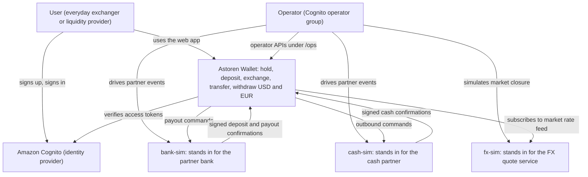
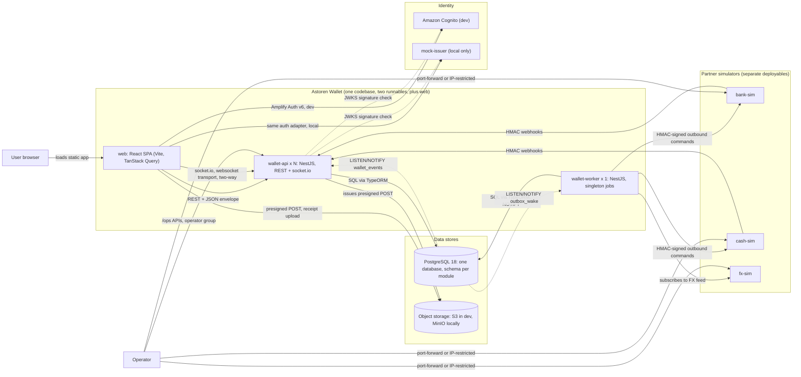
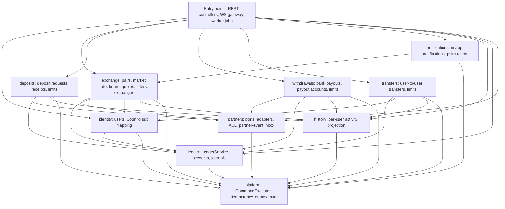

# C4 Model — Astoren Wallet

This is a reader's guide to the shape of the Astoren Wallet pilot, drawn as a [C4 model](https://c4model.com): three zoom levels, from "what talks to what in the world" down to "which modules inside the API may call which". The authoritative rules live in [`ARCHITECTURE-SPINE.md`](../ARCHITECTURE-SPINE.md). This page only explains them, and AD-n ids point back to the spine.

**Pilot context in one paragraph.** Astoren Wallet lets everyday people hold USD and EUR and exchange them, either at the **house quote** (the platform's own rate, a small visible markup on the live market rate) or by taking a better **offer** another user posted on the P2P **board**. In the pilot all money is test money, and every outside party (partner bank, cash partner, FX quote service) is played by a **simulator** that we build and run ourselves.

---

## Level 1 — System Context

*Who uses the system and which outside systems it depends on.*

**Legend.** Boxes are people or systems; arrows show who initiates the interaction. The middle box is the system we build. The three `*-sim` boxes are also built by us, but they play outside parties and are treated as external.

**What to notice**

- The simulators sit **outside** the wallet boundary on purpose. The wallet reaches them only through partner-style interfaces, and there is no "credit my balance" backdoor; balances arrive through deposits (AD-1, AD-4).
- Going live means swapping each simulator for the real partner and changing only the wallet's `partners` adapters and config (AD-4).
- The operator uses two different doors: the wallet's audited `/ops/*` APIs, and the simulators' own controls to trigger partner events or a weekend market closure (AD-26, AD-29, Consistency Conventions "Operator APIs").
- Users never talk to the FX service. Rates reach the browser only through the wallet (AD-18).
- Cognito is the only identity provider in the cloud; locally a mock issuer replaces it (AD-20, see Level 2).

---

## Level 2 — Containers

*The separately running pieces ("containers" in C4 means runnable units, not only Docker containers) and how they talk.*

**Legend.** Solid arrows are calls or data flow in the direction of the arrow. Dotted arrows are background or verification traffic (notifications from Postgres, token key fetches). Cylinders are data stores. `x N` means horizontally scaled; `x 1` means exactly one instance.

**Glossary for this level**

- **LISTEN/NOTIFY**: a built-in PostgreSQL feature where one connection says `NOTIFY channel` and every connection that ran `LISTEN channel` receives a small message. The wallet uses it as a doorbell, not as a message queue.
- **Outbox**: a table where a transaction writes "events to publish" in the same commit as the business change, so an event exists if and only if the change committed.
- **HMAC webhook**: an HTTP callback whose body is signed with a shared secret, so the receiver can tell it really came from the partner and was not altered.
- **Presigned POST**: a short-lived, policy-limited upload permission the API hands the browser, so files go straight to S3/MinIO without passing through the API.

**What to notice**

- `wallet-api` and `wallet-worker` are **two entry points of one NestJS codebase**, not two services. They share one database so a take can settle in a single transaction (AD-1, AD-19).
- Only the worker talks to `fx-sim` and only the worker makes outbound partner calls, and always after the database transaction has committed (AD-4, AD-18, AD-33).
- Real-time updates travel worker -> Postgres `NOTIFY` -> every `wallet-api` instance -> socket.io rooms. `NOTIFY` carries only an outbox id; each instance reads the row itself (AD-18, AD-33).
- Partner webhooks are verified with HMAC-SHA256 and deduplicated by the `partners` inbox before any money moves (AD-4).
- Receipt files never pass through the API: the browser uploads with a presigned POST whose policy caps size at 10 MB and fixes the content type (AD-31).
- The same JWT guard runs everywhere. Locally the mock issuer produces Cognito-shaped tokens, so the auth path is exercised in every environment (AD-20).

---

## Level 3 — Components of wallet-api

*The modules inside the wallet codebase and the only compile-time dependencies allowed between them.*

**Legend.** An arrow `A --> B` means "module A may import and call B's exported service". No arrow means no dependency is allowed. The edges are copied exactly from the spine's dependency diagram and are enforced by `eslint-plugin-boundaries` at build time.

**What to notice**

- Every module is layered `controller -> service -> repository` and owns one Postgres schema. Other modules may call only its **service**; entities and repositories never leave the module (AD-2, AD-3).
- `ledger` and `history` depend only on `platform`. They are the "bottom" of the graph, and only `LedgerService` writes ledger tables (AD-3, AD-5, AD-30).
- `partners` never imports `deposits` or `withdrawals`. Instead those modules implement its `PartnerEventHandler` interface and register with it, which breaks what would otherwise be a cycle (AD-2, AD-4).
- Hexagonal ports and adapters (`PartnerBankPort`, `CashPartnerPort`, `FxFeedPort`) exist **only** in `partners`. Everything else is plain layered code (AD-2).
- No money flow calls `notifications` directly. Notifications react to outbox events through `platform`'s consumer registry, so a failed toast can never roll back a payment (AD-32, AD-33).
- `platform` hosts `CommandExecutor`, the single place a money or status transaction opens (AD-12).

---

## Deployment note: local vs dev

There are exactly two environments, and both run the same Helm charts (one per runnable, with `values-local.yaml` and `values-dev.yaml`), the same PostgreSQL major and the same Kubernetes minor (AD-25, AD-26).

| Concern | local | dev (AWS) |
| --- | --- | --- |
| Kubernetes | minikube | EKS (AWS Free plan) |
| Ingress | minikube nginx ingress | ALB via AWS Load Balancer Controller, routing only to `wallet-api` and the web client |
| PostgreSQL | pod in the cluster | RDS, starts empty each session |
| Object storage | MinIO pod | S3 bucket (session Terraform root) |
| Identity | mock-issuer | Cognito user pool (persistent Terraform root) |
| Secrets | plain Kubernetes Secrets | SSM Parameter Store, synced by External Secrets Operator |
| Logs | `kubectl logs` | Fluent Bit to CloudWatch Logs |
| Simulators | pods in the cluster | ClusterIP only, reached by operators with `kubectl port-forward` or an IP-restricted endpoint |

The dev cloud is **ephemeral**: Cognito, ECR, SSM parameters and the Terraform state bucket are always on, while the VPC, EKS, ALB, RDS and receipt bucket are created and destroyed per working session. One deploy script (build -> push to ECR -> migration Job -> seed Job -> `helm upgrade`) is the only deploy path, whether run from a laptop or from GitHub Actions. See [ADR-26](adr/ADR-26-ephemeral-dev-infrastructure.md).
