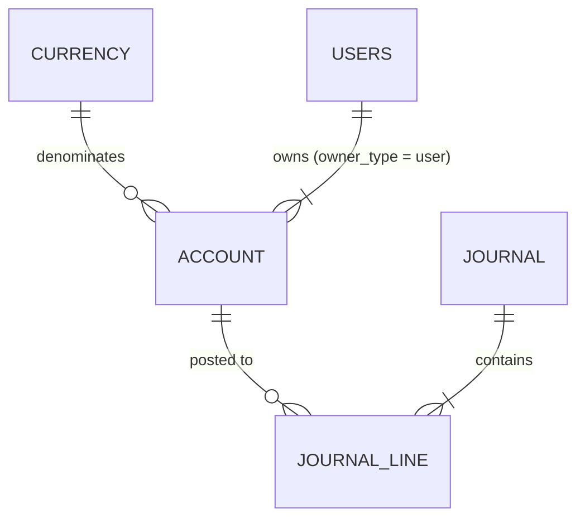

# astoren-wallet - Epic Breakdown

## Overview

This document provides the complete epic and story breakdown for astoren-wallet, decomposing the requirements from the PRD, UX Design if it exists, and Architecture requirements into implementable stories.

Requirement IDs keep the PRD's numbering (FR-n, NFR-n) for traceability. Items tagged **[PENDING DESIGN ROUND]** are in pilot scope, but the architecture has deliberately not designed them yet. Their stories wait for that round.

## Requirements Inventory

### Functional Requirements

**4.1 Wallet and balances (Must)**

- FR-1: A person can sign up with email, password and a required display name, and sign in. The display name is editable later and is shown to transfer senders (FR-24). A new wallet starts at zero in both balances. No identity verification in the pilot.
- FR-2: A user can see available, held and pending amounts per currency. Available never goes below zero. Held funds cannot be spent, withdrawn, transferred or offered again.
- FR-3: A user can see every money movement with its status and timestamps. Deposit statuses: awaiting payment, awaiting confirmation, completed, expired, mismatch. Withdrawal statuses: pending, completed, cancelled, expired, rejected. Status changes appear without a page reload.

**4.2 Deposits (Must)**: bank transfer (EUR via SEPA, USD via US-domestic transfer, no international wires) or cash at a cash partner (USD or EUR)

- FR-4: A user can open a deposit request for amount, currency and method. The wallet issues a unique reference with a check character (catches single typos and adjacent transpositions; a failing reference counts as unknown), and shows the company account details and the all-in cost preview. Requests expire 72 h after opening if not completed **[expiry: PENDING DESIGN ROUND]**. Per-currency limits are 2,000 per request and 5,000 per rolling 30 days, configurable. A request above them is refused.
- FR-5: A user can attach a receipt (image or PDF) with the partner's transaction number to an open deposit request. Status becomes *awaiting confirmation*. The receipt is optional for crediting.
- FR-6: The wallet credits a deposit when a partner confirmation matches an open request's reference, currency and exact amount. The amount goes to available, the request becomes *completed*, and a repeated confirmation never credits twice.
- FR-7 **[PENDING DESIGN ROUND]**: The wallet never auto-credits a non-exact match. Unmatched funds (valid reference, but a different amount or currency, or arrived after close) are kept for that wallet, the open request becomes *mismatch*, and the user sees amount, currency and reason. The user resolves them by opening a request for exactly what arrived, which links and credits immediately with no payment step, and the mismatch request links to its resolver. Deposit limits apply, and above-limit unmatched funds go to back office. Unattributable funds (no reference, or one never issued) go to back office.

**4.3 Withdrawals (Must)**

- FR-8: A user can withdraw from available to a bank account in the same currency after an all-in cost preview. The payout account is entered in the flow and can be saved, and saved accounts can be viewed, edited and removed. The amount moves to pending and leaves the balance on partner confirmation. **[Rejection → return to available: PENDING DESIGN ROUND]**
- FR-9 **[PENDING DESIGN ROUND]**: A user can withdraw cash from available in the same currency and receive a single-use withdrawal code valid 24 h. The amount moves to pending, and the withdrawal becomes *completed* on partner payout confirmation.
- FR-10 **[PENDING DESIGN ROUND]**: A user can cancel an unredeemed withdrawal code, and unredeemed codes expire after 24 h. Either way funds return to available, and history shows *cancelled* or *expired*. Cancel or expiry racing a redemption: exactly one succeeds.
- FR-11: Withdrawal guards. Only available funds can be withdrawn (not uncredited deposits), the same funds can never be withdrawn twice, and per-currency limits are 2,000 per withdrawal and 5,000 per rolling 30 days, configurable.

**4.4 Market rate and house quote (Must)**

- FR-12: The wallet receives the market rate from the FX quote service and updates the quote board on every change.
- FR-13: The house quote is always shown on the board at market rate plus house spread (default 2%, configurable, always larger than a typical tick move). During a scheduled market closure (weekend), the house quotes from the last market rate plus a configurable weekend add-on (default 0%).
- FR-14: A previewed house or pegged-offer rate is locked for 10 s (configurable), and the preview shows the time left. The lock guarantees rate, not amount. On expiry the preview refreshes and the user confirms again. Fixed offers need no lock. Pegged makers accept fills at a rate up to one lock window old.
- FR-15: If the market rate is older than the max age (10 s, configurable), the whole board pauses in both directions. No takes, pre-pause locks are void, a take confirmed during the pause is refused, and new offers are blocked but cancels are allowed. The board shows a "paused, will resume" message (distinct from FR-17), and resumes automatically with the next fresh rate once pegged offers reprice. Not applied during a scheduled closure.
- FR-16: The house fills a take only up to its available balance in the payout currency. A larger take is refused, and the preview shows the house maximum fill. When the house can't fill a direction, its line reads *unavailable right now*. Offers stay takeable, and the worse-than-house rule keeps using the would-be house rate.

**4.5 Quote board and taking (Must)**

- FR-17: A user sees the house quote and open offers for a direction, best rate first, updating live. A taken or cancelled offer leaves the board in < 1 s. If the screen gets no update for 10 s (configurable), a blocking message with **Refresh** appears, and no take can be confirmed from a stale screen.
- FR-18: Before any take, the user sees amount paid, amount received, rate, and total cost in money and as % of market, plus a comparison with a typical ~7% bureau markup.
- FR-19: A user can take an offer (any amount up to its remainder) or the house quote (within FR-16) from available funds. Both sides settle atomically. A partial take leaves the remainder at the same rate. A remainder below the minimum offer size closes the offer and releases it to the maker. Takes fill in arrival order, and a take larger than the remainder on arrival isn't executed. Repeated take requests never execute twice. Users can't take their own offer. Minimum take is 10 USD/EUR, configurable.
- FR-20: A user who loses a take race is told the offer was taken or doesn't have enough left, and nothing is charged. **(Should)** The next-best offer is pre-selected, with the house quote as fallback, for one-tap retry.

**4.6 Posting offers (Must)**

- FR-21: A user can post a fixed or pegged offer from available funds. The amount moves to held. Posting is rate-limited per user, and a minimum offer size applies. Offers worse than the house quote are refused at creation. An open offer that becomes worse than house (market move or spread change) stays on the board greyed out below the house line, can't be taken, shows *out of range* to the maker, keeps its funds held, and becomes takeable again when back in range.
- FR-22: A pegged offer reprices on every market rate change.
- FR-23: A maker can cancel an open offer, and held funds return to available. **(Could, deferred)** Offers expire after a maker-chosen time.

**4.7 Wallet-to-wallet transfers (Should)**

- FR-24: A user can send available funds in the same currency to another wallet identified by email. The sender sees the recipient's display name before confirming. Transfers are instant and irreversible. Daily limit is 1,000 USD/EUR, configurable. **[Linked-wallet self-match guard (wallets that transfer to each other are linked for FR-19): PENDING GUARDRAILS DESIGN ROUND]**

**4.8 Notifications (Should)**

- FR-25: In-app notifications. A maker is notified when their offer is taken (in full or part). A user can set a price alert ("tell me when an offer beats X for USD→EUR"), which fires once when triggered. A user is notified when a deposit or withdrawal changes status.

**4.9 Back office (Must)**

- FR-26 **[PENDING DESIGN ROUND]**: A back-office user can list unattributable funds and link them to a user's open deposit request of the same amount and currency (credits exactly once, closes the funds), and can approve above-limit unmatched funds and credit them. Every action is recorded with who and when. A runbook documents each action and its API calls. API-only, no screens.

**4.10 Simulation controls (Must, pilot only)**

- FR-27: An operator can trigger via simulator API, for any reference or withdrawal code: deposit funds received (any amount, either currency, with or without reference), cash withdrawal code redeemed, and bank payout settled or rejected. Simulators talk to the wallet only as a real partner would.
- FR-28 **[PENDING DESIGN ROUND]**: An operator can make the simulator send a duplicate, late, out-of-order or rejected partner confirmation, or a deposit with the wrong amount or currency, and each produces the outcome FR-6–FR-11, NFR-2 and NFR-3 require.
- FR-29: An operator can set the simulated market rate's drift and volatility, force a jump, stall updates (a long enough stall triggers FR-15), and simulate a market closure (session open/closed, AD-29). The default tick is about 1/s.

### NonFunctional Requirements

- NFR-1 Money correctness: every movement is double-entry and the books always balance. Amounts are exact (no floating-point loss). Rounding favours the house.
- NFR-2 Idempotency: every money-moving request and every partner confirmation is safe to repeat, and a duplicate never moves money twice.
- NFR-3 Partner trust: partner confirmations are authenticated and replay-protected (HMAC, timestamp window, inbox dedupe). **[Out-of-order delivery never producing a wrong balance: PENDING DESIGN ROUND]**
- NFR-4 Real time: market rate, quote board and status changes reach open screens in < 1 s (architecture budget: commit-to-screen p95 < 500 ms).
- NFR-5 Auditability: every status change of a deposit, withdrawal, offer and exchange is kept with a timestamp and is immutable.
- NFR-6 Form factor: a single responsive web app, usable at phone width.
- NFR-7 Replaceable partners: the wallet reaches partners and the FX service only through partner-facing interfaces, and swapping a simulator for a real partner changes no wallet behaviour.
- SM-1 (verifiable): 100% of exchanges have an all-in cost vs market at or below the house spread (plus add-on) in effect at take time. Exchanges snapshot what's needed to audit this (AD-10).
- SM-2 (verifiable): zero ledger imbalances, and every deposit and withdrawal reaches a final status. A reconciliation job in the worker checks this (AD-19).

### Additional Requirements

**Scaffold / starter (impacts Epic 1 Story 1).** No third-party starter template. A greenfield scaffold per the spine source tree:
- pnpm workspaces + Turborepo 2.11.x monorepo with `apps/{wallet-api, web}`, `simulators/{bank-sim, cash-sim, fx-sim, mock-jwt-issuer}`, `packages/{contracts, money}`, `docs/partner-specs/`, `infra/{terraform/persistent, terraform/session, helm, scripts/deploy.sh}`.
- Node 26 LTS, TypeScript 6.x, ESM. NestJS 12 starter for wallet-api (two entry points: `main.ts` api + `worker.ts` worker) and each simulator. Vite 8 + React 19.3 + React Router 8 + TanStack Query 5 + shadcn/ui + Tailwind + lucide-react for web.
- First build story includes a spike: OpenAPI generation from zod v4 schemas on NestJS 12 (whether @nestjs/swagger reads Standard Schema, or via `z.toJSONSchema`).

**Module structure and boundaries (AD-2, AD-3, ADR-2)**
- Layered `controller -> service -> repository` modules: identity, ledger, exchange, deposits, withdrawals, transfers, notifications, history, partners, platform. One Postgres schema per module. Business rules only in services, and cross-module access only via exported services along the allowed dependency graph (C4 L3).
- eslint-plugin-boundaries 5.x enforces the dependency graph and fails the build on violation.
- Hexagonal ports and adapters only in `partners` (`PartnerBankPort`, `CashPartnerPort`, `FxFeedPort`, `PartnerEventHandler` registration). `partners` never imports deposits or withdrawals.
- Deferred learning story (ADR-2 follow-up): re-implement one money flow (FR-19 preferred, FR-6 alternative) in hexagonal + tactical DDD against the same tests, for comparison.

**Platform (AD-12, AD-16, AD-17, AD-21, AD-22, AD-24, AD-33)**
- `CommandExecutor`: the only place money/status transactions open, in a fixed order (dedupe → begin → dedupe row → board/rate FOR SHARE → guarded transition → lockAccounts → checks → effects → outcome → commit). It retries once on deadlock 40P01 and passes `tx` explicitly (no CLS / @Transactional).
- Idempotency: `@Idempotent()` route marker validates the `Idempotency-Key` UUID (missing or malformed → HTTP 400). A dedupe table is unique on `(user_id, key)` with request hash and stored response. Same key with a different body → HTTP 422. Refusals are stored outcomes, concurrent duplicates wait and replay, and keys expire after ~24 h.
- Outbox: rows with `id, seq, type, payload, correlation_id, published_at`, and `pg_notify('outbox_wake')` in the producing tx. The worker relay uses `ORDER BY seq FOR UPDATE SKIP LOCKED` with at-least-once delivery. A consumer registry in platform dedupes consumers on `(consumer_name, outbox_id)` in `platform.consumed_event`. `NOTIFY wallet_events '<outbox id>'` carries only ids.
- Status history: per-module `<entity>_status_history` tables `(id, <entity>_id, from_status, to_status, at, correlation_id, version)`, append-only, in the same tx. `platform.audit` records operator and back-office actions only. Enums grow additively, and clients parse enums leniently.
- Response envelope: `{returnCode: 0, body}` / `{returnCode: 3-digit, errorMessage, body?}`. returnCode ranges per module (1xx platform … 9xx notifications/history), defined only in `packages/contracts`. One exception filter, typed domain errors. errorMessage is never user copy.
- `packages/contracts`: zod v4 schemas for every request, response, error body, returnCode and WS event, validated via NestJS Standard Schema (no class-validator, no nestjs-zod). `version bigint` on every mutable row and balance projection, carried in responses and events. User event shape is `{type, correlationId, resource, id, version, payload}`. Only `LedgerService.post` emits `balance.updated`.
- Correlation id (W3C traceparent-compatible) on every request, job, outbox row, status history row and outbound call. Structured JSON logs to stdout. Never log tokens, HMAC secrets, payout details or withdrawal codes. `/healthz`, `/readyz` (DB + LISTEN). Graceful SIGTERM shutdown within 30 s.

**Ledger and money (AD-5 – AD-9, ADR-5, ADR-9)**
- Three tiers per money move in one tx: business record + status history; exactly one `journal` per `(type, business_ref)` with `journal_line`s (account, signed amount, `balance_after`) summing to zero per currency, append-only; balance projection.
- Closed `JournalType` enum: seed, deposit_credit, withdrawal_hold, withdrawal_settle, offer_hold, offer_release, exchange, transfer. Adding a type is a ledger change.
- Account model: one row per `(owner_type user|house|system, owner_id, currency, bucket)`. Users have available/held/pending with `CHECK (balance >= 0)`. House/system accounts: treasury, cash at partner bank, cash-partner settlement payable, unmatched funds, unattributable funds, rounding/fee revenue, opening equity. User APIs never expose house rows.
- `LedgerService.lockAccounts(tx, ids)` locks all accounts in id order. `post()` asserts the accounts are locked.
- Currencies as data (ISO 4217 + minor-unit exponent). Amounts as integer minor units (`bigint`, JSON `{amountMinor, currency}`). Rates and margins as `numeric(18,8)` / decimal.js / decimal strings. JS `number` arithmetic on money is forbidden.
- `packages/money`: `convert()` (only rounding site; payer rounds up, receiver rounds down, difference goes to house rounding revenue), the better-for-taker comparator, margin helper (maker's "better for me %" → canonical signed margin), column transformers, and `formatMoney`/`formatRate`/`parseAmountInput`/`moneyAriaLabel`.
- Currency pairs: one canonical base/quote per pair, prices as quote-per-1-base (pilot: EUR/USD = USD per 1 EUR). No inverted rate is stored. Say "market rate", never "mid". House price per side gives the taker `(1 − (spread + addOn))` of market value.
- Deposit references: Crockford Base32 uppercase, 10 data chars + 1 check char, stored ungrouped, lookups normalised.

**Exchange domain (AD-10, AD-11, AD-13, AD-14, AD-28, AD-29)**
- Offers store source/target currency, amount and remaining in source currency. Fixed offers store a price. Pegged offers store only a margin, and the effective price is computed per tick. Statuses are `open | filled | cancelled | closed_below_minimum`. Out of range and partially filled are derived flags.
- `ExchangeService.computeBoard(pair, direction)` is the single board computation (effective prices, flags, ordering, house line, `houseMaxFill`).
- Quote (disposable preview row with `expiresAt`, `lockSeconds`) is separate from Exchange (created once at confirm via CommandExecutor, references `quote_id`, snapshots price, market rate, `market_rate_at`, feed sequence, session, spread, add-on and margin).
- Take checks inside the tx: quote owner, not expired, board live, `quote.created_at > paused_at`, rate freshness, not maker, offer open with enough remaining, ≥ min take, not worse than house, house liquidity.
- Guarded transitions only (conditional UPDATE … RETURNING, version+1). 0 rows → re-read for the returnCode. `save()` forbidden on money/state rows.
- Lock order: board_state + market rate FOR SHARE → business row → `lockAccounts` (including the user's available account for limit checks).
- Isolation: READ COMMITTED for writes, REPEATABLE READ READ ONLY for reconciliation and reports.
- `board_state` row per pair (`live | paused | closed`, `paused_at`, `resumed_at`), written only by the worker watchdog with an outbox event. The market is treated as closed until the feed says open.
- Business parameters (spread, weekend add-on, lock window, max rate age, client stale timeout, limits, minimums, posting rate limit, HMAC window) live in owner-module parameter tables, change via an audited `/ops` API under CommandExecutor with an outbox cache-refresh event, and are read in-tx for money checks. `remaining(tx, userId, currency)` per limit; `GET /me/limits`; `GET /config/client`.

**Real-time (AD-18, AD-19, AD-32, ADR-18)**
- Only wallet-worker subscribes to the FX feed. It upserts the market rate row and NOTIFYs. Each wallet-api instance LISTENs on a dedicated direct connection, keeps the latest state in memory only for pushes and previews, and re-reads on reconnect.
- socket.io 4.8 (websocket transport only), rooms `board:<pair>:<direction>` plus a per-user room. A full board snapshot per direction on every tick and offer event, with per-socket takeable flags and feed sequence. A `board.state` frame at least every 3 s. A session snapshot (balances, board state, unread count) on every (re)connect. Disconnect at token expiry.
- wallet-worker is a singleton (replicas 1, Recreate) running FX ingest, board-state watchdog, outbox relay and consumers, price-alert evaluation, SM-2 reconciliation job (structured log line) and housekeeping (expired idempotency keys, old quotes).
- Price alerts are evaluated by the worker after each board recompute against the best takeable price, with a guarded `armed → triggered` transition (fires once) and a unique constraint against duplicates. `notification.created` alone drives toasts and the unread count.

**Identity and auth (AD-20)**
- Cognito user pool (dev) with custom in-app forms via Amplify Auth v6 and email verification on. A mock JWT issuer locally behind a config-selected auth adapter.
- A single JWT guard (JWKS signature, `iss`, `token_use=access`, `client_id`) in every environment, with no bypass. The socket.io handshake carries the token.
- `POST /me` with display name → `ProvisionUser` (`ON CONFLICT (cognito_sub) DO NOTHING`) creates ledger accounts in the same tx when the insert wins. identity owns `sub → user_id`, email (unique) and display name.
- Operators are a Cognito `operator` group, with a role guard on `/ops/*`, forbidden → 1xx, and every action audited.
- Recipient lookup by email is rate-limited per user and returns only display name + opaque recipient id.

**Partner edge and simulators (AD-1, AD-4, ADR-1)**
- `simulators/{bank-sim, cash-sim, fx-sim}` (plus `simulators/mock-jwt-issuer`): separate single-instance NestJS apps with in-memory state, never importing wallet code, workspace packages or each other (lint-enforced). Wire specs live in `docs/partner-specs/{bank,cash,fx}.md` and are duplicated, not shared.
- HMAC-SHA256 over `timestamp + "." + rawBody` with `X-Signature`/`X-Timestamp` headers and a timestamp window, both directions. Partner routes are exempt from the JWT guard and the envelope.
- The partners inbox row is the sole dedupe for partner events (insert → translate → handler(tx) → record outcome → commit → ack).
- Outbound partner calls never run inside a tx. The tx writes an outbox command, and the worker calls the port after commit with the business id as the partner idempotency key.
- The wallet exposes no credit or backdoor endpoint.

**Receipts (AD-31)**
- `ReceiptStore` port owned by deposits, backed by S3 (dev) or MinIO (local, pinned community image). The presigned POST policy enforces `content-length-range 1..10485760` and a fixed Content-Type (jpeg/png/pdf). The client uploads directly, then `POST /deposits/:id/receipt {fileKey, transactionNumber}` with an Idempotency-Key. Only key, type, size and sha256 are stored.

**History (AD-30)**
- `history` module: activity rows unique on `(user_id, movement_type, movement_id)`, one per affected participant. Written only by the owning module in its tx via `HistoryService.record` / `update` (version-guarded). Keyset pagination 25/page with filters currency/type/status. "In progress" = `is_final=false` ordered by `expires_at`.

**Data and migrations (AD-23)**
- TypeORM ≥ 1.1.3, `synchronize: false`. CLI-generated, human-reviewed migrations run by a Kubernetes Job before rollout. Reference data (currencies, pairs, house/system accounts, default parameters) lives in migrations. Test users and balances come from an idempotent seed Job (local + dev only) posting `seed` journals against opening equity. Seeded users map to existing Cognito subs in dev.

**Infrastructure and deployment (AD-25, AD-26, ADR-26)**
- Environments `local` (minikube 1.36, Postgres 18 pod, MinIO pod, simulator pods, mock issuer, everything reachable via minikube ingress) and `dev` (AWS EKS 1.36, RDS Postgres 18.6, S3, Cognito). Same PG major and K8s minor in both.
- Infra config only from env vars / mounted Secrets, zod-validated at boot (fail fast). Dev secrets live in SSM SecureString, synced by External Secrets Operator via EKS Pod Identity (`ssm:GetParameter*`, `kms:Decrypt`). Nothing is configured by hand in the console.
- Two Terraform roots: `persistent` (Cognito, ECR, SSM, state bucket; always on) and `session` (VPC public subnets with no NAT, EKS, ALB, RDS starting empty, S3 receipts; applied and destroyed per session).
- The ALB routes only to wallet-api and web. Simulators are ClusterIP, reached by operators via port-forward or an IP-restricted endpoint (IPs in untracked tfvars).
- One Helm 4 chart per runnable (`values-local.yaml`/`values-dev.yaml`). One deploy script (build → push ECR → migration Job → seed Job → helm upgrade) is the only path, run locally or by GitHub Actions. Fluent Bit sends logs to CloudWatch in dev. The ingress idle timeout must be more than 2× the socket.io ping interval.

**Testing (AD-27)**
- Money logic tests run against real PostgreSQL via Testcontainers, never a mocked DB. Required concurrency tests: two takers on one offer; opposite-direction transfers + house takes (no deadlock); concurrent requests against one limit; duplicate idempotency keys in flight; lost race then next-best confirm with a new key; redelivered outbox event consumed once; `post()` refusing unlocked accounts.

**Architecture → UX/PRD handoffs still open (from spine Handoffs)**
- Verify-email code screen (Cognito email verification is on): needs UX.
- Copy for "server stays unreachable" on confirm: "check Activity before trying again" instead of "Nothing has moved".
- Rate display direction toggle (quote-per-base vs inverse): priority, placement, default, persistence.
- Price alert re-arm after firing (architecture fires once).
- "Expiry pending" neutral wording on non-final items past `expiresAt` until expiry jobs ship.

### UX Design Requirements

**Design tokens and foundation**

- UX-DR1: Implement the DESIGN.md colour tokens as shadcn/Tailwind CSS variables for light and dark themes (background, foreground, card, muted, border, input, ring, primary, accent, destructive, status-success/warning/neutral, test-banner), with dark resolving each `x` to `x-dark`. Theme preference is stored in localStorage with a safe default.
- UX-DR2: Typography. Inter as the sans family, JetBrains Mono for codes and references, and tabular numerals (`tnum`) on every amount, rate, code and countdown. Type ramp tokens: amount-display 36/600, amount-lg 24/600, title 20/600, body 16/400, label 14/500, caption 13/400, code 28/600 with wide tracking.
- UX-DR3: Radius scale (sm 8, md 12, lg 16, xl 24, full) and spacing tokens (gutter-mobile 16, gutter-desktop 24, touch-target 44, button-height 48, row-min 64, content-max 560, board-max 1040). Raised shadow only on the preview sheet and withdrawal code card. Depth in dark theme comes from card colour.
- UX-DR4: Hard colour rule. Rates, balances, offers and amounts are never green or red and never coloured by direction of change. Status colours are for lifecycle status only. Re-verify the 4.5:1 contrast and the 3:1 input-boundary contrast whenever a token changes.

**Global chrome and navigation**

- UX-DR5: Test-money banner (pilot). A full-width amber strip pinned at the very top of every screen including sign-in, reading "Test money — no real value", in the `banner` landmark and read once per page.
- UX-DR6: "Reconnecting…" strip directly below the banner while the socket is reconnecting. After 10 s without board updates, the stale-screen state applies.
- UX-DR7: Navigation shell. On phones (< lg), a bottom tab bar Home · Exchange · Activity · Account and a header with the notifications bell (unread dot in primary). At lg+, a left sidebar replaces the tabs. Add money, Withdraw and Send open as full-screen flows with a back arrow.
- UX-DR8: Primary button. Primary fill, md radius, 48 px tall, full-width sticky footer on phones (thumb reach), inline at the end of the form on desktop.

**Reusable components**

- UX-DR9: Status pill. A full-radius badge with a lucide icon + label in PRD vocabulary, mapped per the DESIGN.md status table (awaiting payment, awaiting confirmation, mismatch, pending, completed, expired, cancelled, rejected, open, partially filled, out of range). Unknown enum values fall back to a neutral pill (lenient parsing). Never colour-only.
- UX-DR10: Status timeline. A vertical list of every status with timestamp (past = filled foreground dot, current = primary ring dot, future = hollow muted dot with no timestamp). Updates live, and the mismatch step shows a "Resolved by deposit A9…" link after a claim.
- UX-DR11: Amount input. amount-lg with the currency suffix and input-coloured border, a numeric keypad on phones, an "N available" caption, a "Use all" chip, and inline limit/minimum/insufficient errors as the user types (driven by `/config/client` and `/me/limits`, advisory only). Parsing only via `packages/money.parseAmountInput`.
- UX-DR12: Balance card. Flag + currency code, available in amount-display, and separate **Held** and **Pending** footer buttons (≥ 44 px, always shown even at zero). Held → My offers. Pending → the pending movement (or Activity filtered to pending if several). The body → Activity filtered to the currency. Live updates without animation.
- UX-DR13: Direction switch. A two-segment full-radius Tabs pill (USD → EUR / EUR → USD) that remembers the last choice (localStorage) and keeps the number in the last-typed field when switching.
- UX-DR14: Quote board rows, four variants: house (muted, "House rate · Guaranteed fallback"), better-than-house (accent, "Better than house by X%"), your offer (card + 1 px primary border, not tappable), out of range (transparent, dashed border, dimmed rate, label in foreground). Each row shows rate, Fixed/Pegged, what you'd pay and amount available. Min height 64 px.
- UX-DR15: Quote board behaviour. Best first, with the house row sorted into place (better offers above, out-of-range below). Rows update in place, a taken or cancelled row disappears within 1 s, and a reorder waits 300 ms after the last touch. Linked-wallet rows read "Not available to you" **[depends on FR-24 guardrails round]**. Empty state: house row + "No offers right now…".
- UX-DR16: Exchange preview sheet. A bottom Drawer on phones, docked panel at lg ("Pick a rate to see the full cost." before selection). Order: You pay, You get (amount-display), rate, total cost (money + %), bureau comparison line, lock countdown, Confirm. Messages appear as an Alert at the top.
- UX-DR17: Lock countdown. A thin Progress in primary on a muted track, "Rate held · 7s", computed from `lockSeconds` minus a 0.5 s margin. It never turns red and never auto-confirms. Fixed offers show "Fixed rate, no timer". It is announced on open ("Rate held for 10 seconds") and at 3 s.
- UX-DR18: Post an offer. Offer type selector (RadioGroup cards: Fixed rate / Pegged to market with a "market ± %" stepper in 0.05% steps, showing the live resulting rate), and a preview with no lock showing the held amount, rate, receive-at-today's-rate and "€X will be held while your offer is open".
- UX-DR19: My offers row. Current (live) rate, Fixed/Pegged, "€860 of €1,500 left" with a thin Progress, a status pill (open / partially filled / out of range), and a ghost **Cancel**.
- UX-DR20: Deposit reference block. The reference in code typography grouped in fours with Copy (copied value ungrouped), then bank account details or "Show this reference at the counter", then "Pay by <72h deadline>".
- UX-DR21: Receipt attach. An outline "Attach receipt" button (file picker, camera on phones, silent fallback if permission is denied), a required "Transaction number" input, the attached file row with remove, and a **Send receipt** button active only when both are present. Errors: "Use an image or PDF up to 10 MB"; on upload failure, Retry and the status stays awaiting payment.
- UX-DR22: Withdrawal code card **[PENDING DESIGN ROUND with FR-9/FR-10]**. The code in code typography on muted with a raised shadow, the amount, "Valid until … · Nh left", Copy and Cancel (full screen only, with a confirm dialog "Cancel and return $300 to available?" Cancel code / Keep code). A compact Home version without Cancel.
- UX-DR23: Unmatched funds row **[PENDING DESIGN ROUND with FR-7]**. A mismatch pill, "$750 arrived under reference A7KD… (expected $800)", and an inline **Claim $750** opening Add money pre-filled.
- UX-DR24: "In progress" list (Home). Every non-final movement (deposits awaiting payment or confirmation, mismatch, pending withdrawals, codes, open offers collapsed to "N open offers"), sorted by soonest expiry and hidden entirely when empty. Non-final items past `expiresAt` show neutral "expiry pending" wording until expiry jobs ship.
- UX-DR25: Notifications inbox and toasts. The bell's unread dot, unread rows in label weight + dot, tap → mark read + open detail, "Mark all read". Sonner toasts for fills, status changes and triggered alerts, tappable to the detail, driven only by `notification.created`.
- UX-DR26: Price alert form. Direction + threshold rate pre-filled from the board's "Alert me". Duplicate → "You already have this alert" and nothing is created. List and delete in Account.
- UX-DR27: Copy affordance. A Copy button on codes and references showing "Copied" for 1.5 s. The copied value excludes grouping spaces.

**State patterns (each needs an implemented treatment)**

- UX-DR28: Board states: rates paused (inline Alert, rows dimmed and untappable, Confirm disabled, open lock cancelled, "Post your own rate" disabled, cancels allowed), weekend closure (house row caption), house unavailable (house row dimmed with "House rate unavailable right now"), above house capacity ("The house can fill up to $X" + one-tap "Use $X").
- UX-DR29: Preview states: lock expired (refresh in place, "Rate updated. Check and confirm again."), lost race taken ("That offer was just taken. Nothing was charged." with next-best pre-selected or house), lost race not enough ("Only $400 is left…" with **Take $400** or the next-best for the full amount).
- UX-DR30: Stale-screen blocking dialog after 10 s (configurable via `/config/client`) with no update: "We couldn't update rates. Check your connection." + **Refresh**, the only overlay allowed above a sheet, and nothing confirmable beneath it.
- UX-DR31: Confirm-in-flight. The button disables + spinner ("Checking…") until the server answers. It resends the same body + Idempotency-Key with backoff (AD-16), with a new key only after a definitive refusal. Final copy for "server stays unreachable" is pending the UX handoff ("check Activity before trying again").
- UX-DR32: Offer states: worse than house (inline "Try 1.0900 or better", Post disabled), below minimum, rate-limited ("Try again in a minute"), out of range (pill + message + Cancel), remainder below minimum (toast "Your offer closed. The remaining $4…").
- UX-DR33: Money-movement states: zero balances ("Add money to get started"), limit/minimum inline, insufficient available ("$380 is held in your offers" → My offers), deposit completed (pill + "$800.00 is in your USD balance", reference shrinks, receipt hidden), recipient not found, final-status detail with "where the money is now". Rejected/expired/cancelled/mismatch/claim/reference-forgotten states come with the pending design round.
- UX-DR34: Account and auth states: "That email and password don't match." (never says which one), "There's already a wallet with this email. Sign in instead?", session expired → Sign in → return to the same surface (discard unconfirmed preview). Verify-email code screen **[UX handoff open]**.
- UX-DR35: Empty states for board, My offers, Activity, Notifications, Price alerts, Saved payout accounts, as specified in EXPERIENCE.md. Skeleton rows matching the layout on every list cold load.

**Interaction, voice, accessibility, responsive**

- UX-DR36: Interaction primitives. An explicit one-tap confirm after preview for every money movement (no swipe or hold), no optimistic updates for money (preferences only), live updates without motion, `prefers-reduced-motion` respected, sheets swipe-dismissable except while a confirm is in flight, modals at most one level deep. Banned: pull-to-refresh on board, infinite scroll (Activity paginates 25/page), hover-only affordances, auto-take.
- UX-DR37: Voice and tone. A single client returnCode → copy table, "exchange, never trade" vocabulary, never "spread"/"bid"/"ask"/"P&L" in UI, "House rate" as the UI label for house quote, cost always in money and %, no celebratory savings copy. Rates at 4 dp, money at 2 dp, locale-formatted via `packages/money`, with the currency code wherever it could be confused.
- UX-DR38: Accessibility floor (WCAG 2.2 AA). The board isn't aria-live: a polite "Rates updated" at most every 10 s, and assertive announcements for lost race, pause and stale screen. Codes and references are read character by character via aria-label. Amounts are read with the currency name (`moneyAriaLabel`). 44 px targets, always-visible focus rings, desktop keyboard (reading-order tab, Enter confirms, Esc closes topmost).
- UX-DR39: Responsive layout. < md single column with 16 px gutters and bottom drawers; md centred at 560 px; ≥ lg sidebar, board widened to 1040 px with preview/Post an offer docked right, Home balance cards side by side and "In progress" beside recent activity. Browser only, no PWA.
- UX-DR40: Surfaces to build (EXPERIENCE.md IA): Sign up/Sign in, Home, Exchange (board), Exchange preview, Post an offer, My offers, Add money, Deposit detail, Withdraw, Withdrawal code **[pending round]**, Send, Activity (filters currency/type/status, 25/page), Movement detail, Notifications, Price alerts, Account (profile/display name, saved payout accounts with edit/remove, price alerts, theme, sign out).

### FR Coverage Map

| FR | Epic | Notes |
|---|---|---|
| FR-1 | Epic 1 | Sign up (display name, verify email), sign in, provisioning; real Cognito wired in Epic 2 |
| FR-2 | Epic 1 | Balance buckets and Home cards; live `balance.updated` arrives with Epic 3 |
| FR-3 | Epics 3, 5, 6, 7, 9, 10 | History projection + Activity introduced in Epic 3 (exchanges); each later epic adds its movement type and statuses |
| FR-4 | Epic 5; Epic 10 | Request, reference, limits in Epic 5; 72 h expiry in Epic 10 ⏸ |
| FR-5 | Epic 5 | Receipt attach (presigned POST, MinIO/S3) |
| FR-6 | Epic 5 | Credit on exact match via partners inbox |
| FR-7 | Epic 10 ⏸ | Unmatched and unattributable funds, claim |
| FR-8 | Epic 6; Epic 10 | Payout + settle + saved accounts in Epic 6; rejection → available in Epic 10 ⏸ |
| FR-9 | Epic 9 ⏸ | Cash withdrawal code |
| FR-10 | Epic 9 ⏸ | Cancel, expiry, cancel/expire vs redeem race |
| FR-11 | Epic 6 | Withdrawal guards and limits (re-applied in Epic 9 for cash) |
| FR-12 | Epic 3 | FX feed ingest, market rate row, board update per tick |
| FR-13 | Epic 3 | House quote, spread, weekend closure + add-on |
| FR-14 | Epic 3 | Quote lock (house); pegged-offer lock in Epic 4 |
| FR-15 | Epic 3 | Staleness pause and resume; offer posting/cancel rules during pause finished in Epic 4 |
| FR-16 | Epic 3 | House liquidity limit, house max fill, house unavailable |
| FR-17 | Epic 3 | Live board, stale-screen block; offer rows in Epic 4 |
| FR-18 | Epic 3 | All-in cost preview with bureau comparison |
| FR-19 | Epic 3 (house take); Epic 4 (offer take) | Atomic settlement, minimum take, idempotent take; arrival order, partial fill, self-take, below-minimum close in Epic 4 |
| FR-20 | Epic 4 | Lost race + next-best pre-select (Should) |
| FR-21 | Epic 4 | Post fixed/pegged, held, rate limit, minimum, worse-than-house, out of range |
| FR-22 | Epic 4 | Pegged repricing per tick |
| FR-23 | Epic 4 | Cancel offer; offer expiry (Could) deferred, no story |
| FR-24 | Epic 7 | Transfer by email with display name, daily limit; linked-wallet guard as last story ⏸ |
| FR-25 | Epic 8 | Notifications inbox, toasts, price alerts (fire once) |
| FR-26 | Epic 10 ⏸ | Back-office API + runbook + audit |
| FR-27 | Epics 5, 6, 9 | Deposit received (5), payout settled (6), code redeemed (9 ⏸); payout rejected in Epic 10 ⏸ |
| FR-28 | Epic 10 ⏸ | Failure injection |
| FR-29 | Epic 3 | fx-sim operator controls: drift, volatility, jump, stall, session closure |

**NFRs and metrics**

| Item | Where |
|---|---|
| NFR-1 Money correctness | Epic 1 (ledger, `packages/money`, seed via journals); enforced by every money epic |
| NFR-2 Idempotency | Epic 3 (CommandExecutor + idempotency table, client key lifecycle in the confirm flow); every later money epic |
| NFR-3 Partner trust | Epic 5 (HMAC, timestamp window, inbox dedupe); out-of-order in Epic 10 ⏸ |
| NFR-4 Real time | Epic 3 (outbox relay, LISTEN/NOTIFY, socket.io, session snapshot) |
| NFR-5 Auditability | Epic 3 (status-history pattern with exchanges, `platform.audit` with the first `/ops` API); each epic adds its tables |
| NFR-6 Form factor | Epic 1 (responsive shell, tokens); every UI story |
| NFR-7 Replaceable partners | Epic 3 (FxFeedPort), Epic 5 (bank/cash ports, partner specs), Epic 6 (outbound commands) |
| SM-1 House ceiling | Epic 3 (exchange snapshot); Epic 4 (offers) |
| SM-2 Money integrity | Epic 1 (reconciliation job in worker skeleton); final-status part completes with Epics 9–10 |

**UX design requirements**: UX-DR1–DR10, DR27, DR34–DR40 base in Epic 1; DR11, DR13–DR17, DR28–DR31 in Epic 3; DR18, DR19, DR32 in Epic 4; DR20, DR21, DR24 in Epic 5; DR33 split across Epics 5–7; DR25, DR26 in Epic 8; DR22 in Epic 9 ⏸; DR23 in Epic 10 ⏸. DR12 starts in Epic 1 (cards) and gains Held/Pending targets as Epics 4 and 6 land.

**Explicitly not covered (deferred by PRD or spine):** FR-23 offer expiry (Could), metrics and alerting epic, OpenTelemetry, worker HA, Redis, additional currencies, production/staging environments.

## Epic List

⏸ = in pilot scope, stories written after the dedicated unhappy-path / guardrails design round.

### Epic 1: Wallet foundation: sign up, sign in, see my balances
A person can create a wallet with email, password and display name (with email verification), sign in, and see USD and EUR balance cards split into available, held and pending, under the test-money banner. They can edit their display name in Account. Seeded test users start with balances. Behind it: the monorepo scaffold (Story 1.1, including the OpenAPI-from-zod spike), `packages/contracts` and `packages/money`, the platform module (CommandExecutor, idempotency, envelope/returnCodes, correlation id, logging, health), ledger with migrations and the seed Job, identity with the mock issuer and the config-selected auth adapter, eslint boundaries, the Testcontainers harness, the worker skeleton with the SM-2 reconciliation job, the web shell with design tokens and navigation, and the single deploy script onto local minikube with Helm.
**FRs covered:** FR-1, FR-2

### Epic 2: Pilot on AWS (dev environment)
Testers can reach the wallet on the internet and sign up with real Amazon Cognito, on infrastructure that is created and destroyed per working session. Covers both Terraform roots (persistent: Cognito with the operator group, ECR, SSM, state bucket; session: VPC without NAT, EKS, ALB, RDS, S3), External Secrets Operator via Pod Identity, Fluent Bit to CloudWatch, Helm `values-dev.yaml`, and GitHub Actions running the same deploy script. From here on, every epic deploys to dev too.
**FRs covered:** FR-1 (real identity provider); enables all later epics (AD-25, AD-26)

### Epic 3: Exchange at the house rate, live
A user opens Exchange, switches direction, and sees the house rate following the live market from fx-sim. They preview the all-in cost with a 10-second rate lock and take the house rate atomically, and see the exchange in Activity with balances updating live. Paused rates, weekend closure, house capacity limits and the stale-screen block all behave as specified. Operators drive the simulated market (drift, volatility, jump, stall, closure) and change business parameters through audited `/ops` APIs. Introduces the outbox relay, LISTEN/NOTIFY fan-out, socket.io gateway with session snapshot, board-state watchdog, `computeBoard`, the history projection with the Activity screen, and the client idempotency-key confirm flow.
**FRs covered:** FR-3 (exchanges), FR-12, FR-13, FR-14, FR-15, FR-16, FR-17, FR-18, FR-19 (house take), FR-29

### Epic 4: P2P offers: post your own rate, take better ones
A user can post a fixed or pegged offer (funds held, rate-limited, minimum size, never worse than house), watch a pegged offer reprice and go out of range and back, and cancel it from My offers. Other users can take offers better than the house rate in any amount, filled in arrival order, with partial fills and closing below the minimum. A user who loses a race is told nothing was charged and gets the next-best rate pre-selected. Includes the required concurrency tests (two takers on one offer, a lost race followed by a new-key confirm), plus an optional final story that re-implements the take in hexagonal + tactical DDD for comparison (ADR-2).
**FRs covered:** FR-19 (offer takes, self-take, below-minimum close), FR-20, FR-21, FR-22, FR-23

### Epic 5: Add money by bank transfer or cash
A user opens a deposit request (bank transfer or cash, within per-request and rolling 30-day limits) and gets a check-character reference and payment instructions. They attach a receipt and transaction number, and watch the deposit move to completed live when the partner confirms. Home shows "In progress". Introduces the partners anti-corruption layer (HMAC both ways, partner-event inbox, `PartnerEventHandler`), `docs/partner-specs/`, bank-sim and cash-sim with operator "deposit received" controls, and the `ReceiptStore` (MinIO locally, S3 in dev).
**FRs covered:** FR-3 (deposits), FR-4 (request, reference, limits), FR-5, FR-6, FR-27 (deposit received)

### Epic 6: Withdraw to my bank account
A user withdraws from available to a bank account in the same currency after an all-in cost preview. They enter and save a payout account (and can view, edit and remove saved accounts in Account), see the amount pending, and then see it completed when bank-sim settles. Withdrawal limits and guards apply. Introduces outbound partner commands via the outbox, called by the worker after commit with the business id as the partner idempotency key.
**FRs covered:** FR-3 (withdrawals), FR-8 (payout, settle, saved accounts), FR-11, FR-27 (payout settled)

### Epic 7: Send money to a friend
A user enters a recipient's email, sees their display name (rate-limited lookup), and sends funds in the same currency instantly and irreversibly within a daily limit. Both wallets and both Activity lists update at once. Last story ⏸: the linked-wallet self-match guard, after the guardrails design round.
**FRs covered:** FR-24

### Epic 8: Notifications and price alerts
A maker is notified when an offer fills, fully or in part. Users are notified when a deposit or withdrawal changes status. A user can set a price alert from the board ("tell me when an offer beats X"), which fires once against the best takeable price, and can list and delete alerts in Account. Covers the in-app inbox with unread count and toasts driven only by `notification.created`.
**FRs covered:** FR-25

### Epic 9: Cash withdrawal by code ⏸
A user withdraws cash from a same-currency balance, gets a single-use code valid 24 hours, and collects it at a cash partner (cash-sim). They can cancel the code, and it expires on its own if not collected. Cancel or expiry racing a redemption has exactly one winner. Stories are written after the design round (code generation, storage, exposure, expiry, redeem).
**FRs covered:** FR-9, FR-10, FR-27 (code redeemed)

### Epic 10: When money doesn't go to plan ⏸
Users and back office can recover every off-path deposit and payout. Unmatched funds put the request into mismatch, and the user claims them. Back office links unattributable funds and approves above-limit claims via an audited API with a runbook. Deposit requests expire after 72 hours. Rejected bank payouts return to available. Operators inject duplicate, late, out-of-order, rejected or wrong-amount confirmations, and each produces the required outcome. Stories are written after the design round.
**FRs covered:** FR-7, FR-26, FR-28, FR-4 (expiry), FR-8 (rejection), FR-27 (payout rejected), NFR-3 (out-of-order)

## Epic 1: Wallet foundation: sign up, sign in, see my balances

A person can create a wallet with email, password and display name (with email verification), sign in, and see USD and EUR balance cards split into available, held and pending, under the test-money banner. Seeded test users start with balances. Everything runs on local minikube through the single deploy script.

### Database design

The tables this epic introduces. Each story still writes only the migration for the tables it needs (Story 1.3 creates the empty schemas, Story 1.5 the ledger tables, Story 1.6 the identity table). Conventions: `snake_case`, singular table names (except `users`, because `user` is reserved in Postgres), UUID primary keys, `timestamptz`, and `version bigint` on every mutable row (AD-22).

| Schema.table | Columns (key ones) | Constraints and indexes | Written by |
|---|---|---|---|
| `ledger.currency` | `code char(3)` PK, `exponent smallint`, `active boolean` | Reference data in a migration: USD 2, EUR 2 | migration only |
| `ledger.account` | `id uuid` PK, `owner_type` (`user \| house \| system`), `owner_id uuid`, `currency` FK, `bucket` (`available \| held \| pending \| treasury \| cash_at_partner_bank \| opening_equity \| rounding_revenue`, extended additively by later epics), `balance bigint`, `version bigint`, `created_at` | UNIQUE `(owner_type, owner_id, currency, bucket)`; CHECK `owner_type <> 'user' OR balance >= 0`; CHECK user rows use only `available \| held \| pending` | `LedgerService` only |
| `ledger.journal` | `id uuid` PK, `type` (closed `JournalType`, starts as `seed`), `business_ref uuid`, `correlation_id`, `created_at` | UNIQUE `(type, business_ref)`; append-only | `LedgerService.post` |
| `ledger.journal_line` | `id uuid` PK, `journal_id` FK, `account_id` FK, `currency`, `amount_minor bigint` (signed), `balance_after bigint` | Index `(account_id, id)`; append-only; per-currency sum = 0 enforced in `post()` and checked by reconciliation | `LedgerService.post` |
| `identity.users` | `id uuid` PK, `cognito_sub text`, `email text`, `display_name text`, `version bigint`, `created_at`, `updated_at` | UNIQUE `cognito_sub`; UNIQUE `lower(email)`; `display_name` not blank | `identity` (`ProvisionUser`, profile update) |

**Design choice to confirm in Story 1.5:** the balance projection (AD-5 tier 3) is held as the `balance` + `version` columns on `ledger.account` (one row per account), not as a separate table. This keeps `lockAccounts` and the projection update on the same row. House/system accounts use a fixed, well-known `owner_id` per owner type, seeded by migration.

### Story 1.1: Monorepo scaffold and toolchain

As a developer,
I want a pnpm + Turborepo monorepo with the wallet's runnables and shared packages scaffolded,
So that every later story builds, lints and tests the same way from day one.

**Acceptance Criteria:**

**Given** a fresh clone
**When** I run `pnpm install && pnpm turbo build lint test`
**Then** it succeeds on Node 26 LTS with TypeScript 6.x and ESM
**And** the tree matches the spine: `apps/wallet-api` (with `src/main.ts` api and `src/worker.ts` worker entry points, NestJS 12), `apps/web` (Vite 8 + React 19.3 + React Router 8 + TanStack Query 5 + Tailwind + shadcn/ui + lucide-react), `packages/contracts` (zod v4), `packages/money` (decimal.js), `docs/partner-specs/`, `infra/{terraform,helm,scripts}`
**And** `simulators/{bank-sim, cash-sim, fx-sim, mock-jwt-issuer}` exist as NestJS 12 stubs (one placeholder route with a static dummy payload, one test), and a test import from any of them into `apps/`, `packages/` or a sibling simulator fails `pnpm lint`

**Given** the module list in AD-3
**When** I inspect `apps/wallet-api/src`
**Then** empty Nest modules exist for identity, ledger, exchange, deposits, withdrawals, transfers, notifications, history, partners and platform
**And** eslint-plugin-boundaries encodes exactly the spine's dependency graph (C4 Level 3), and a test import that violates it (e.g. `ledger` importing `exchange`, or `partners` importing `deposits`) fails `pnpm lint`
**And** across an allowed edge only `*.service.ts`, `*.module.ts` and `*.types.ts` may be imported, so a test import of another module's entity or repository (e.g. `exchange` importing `ledger/account.entity.ts`) fails `pnpm lint`

**Given** the open question on OpenAPI from zod on NestJS 12
**When** the spike runs on one sample route
**Then** a short decision note in `docs/` records whether `@nestjs/swagger` reads the Standard Schema route option or docs are assembled via `z.toJSONSchema`, and the chosen approach serves an OpenAPI document locally

### Story 1.2: API conventions: config, envelope, errors, logging and health

As a developer,
I want wallet-api's cross-cutting conventions in place before any business endpoint exists,
So that every module returns the same envelope, logs the same way and fails fast on bad config.

**Acceptance Criteria:**

**Given** wallet-api or wallet-worker starts
**When** a required environment variable is missing or invalid
**Then** the process exits at boot with a zod validation message naming the variable (AD-25)

**Given** any successful user-facing REST call
**When** the response is sent
**Then** the body is `{ "returnCode": 0, "body": ... }`, and a thrown typed domain error is turned by the single exception filter into `{ returnCode, errorMessage, body? }` with the HTTP status chosen independently (AD-21)
**And** returnCode constants and ranges (0, 1xx–9xx) and the envelope schemas live only in `packages/contracts`, and an inbound payload failing its zod schema returns a 1xx validation code via NestJS Standard Schema validation (AD-22)

**Given** an inbound request with or without a `traceparent` header
**When** it is handled
**Then** a W3C-compatible correlation id is reused or created, and every log line is structured JSON on stdout with `level`, `msg`, `correlationId`, `module`
**And** a test asserts that tokens and secrets passed through a request are not present in log output (AD-24)

**Given** a running wallet-api or wallet-worker
**When** `/healthz` and `/readyz` are called
**Then** liveness answers 200, and readiness reports the database connection
**And** on SIGTERM wallet-api stops accepting requests and exits within 30 s

### Story 1.3: Database, migrations and local cluster deploy

As a developer,
I want PostgreSQL with migrations and a one-command deploy to local minikube,
So that every later story ships the same way it will ship to dev.

**Acceptance Criteria:**

**Given** TypeORM ≥ 1.1.3 configured with `synchronize: false`
**When** I generate a migration with the TypeORM CLI
**Then** it lands in a committed migrations folder, and an initial migration creates one schema per AD-3 module

**Given** minikube pinned to Kubernetes 1.36 and Helm 4
**When** I run `infra/scripts/deploy.sh local`
**Then** it builds images, runs a migration Kubernetes Job against a PostgreSQL 18 pod, then `helm upgrade`s one chart per runnable (wallet-api, wallet-worker, web) using `values-local.yaml`
**And** wallet-worker's Deployment has `replicas: 1` and `strategy: Recreate`, and apps never migrate at startup (AD-23, AD-26)
**And** web and wallet-api are reachable through minikube ingress, with secrets from plain Kubernetes Secrets

**Given** the Testcontainers harness in `apps/wallet-api`
**When** an integration test runs
**Then** it starts real PostgreSQL 18, applies all migrations and gives the test a clean database (AD-27)

### Story 1.4: Money basics in `packages/money`

As a developer,
I want one shared way to represent, format and parse amounts,
So that no code ever does float arithmetic on money and every screen shows amounts the same way.

**Acceptance Criteria:**

**Given** an amount
**When** it is represented in TypeScript or JSON
**Then** it is `bigint` minor units in code and `{ "amountMinor": <integer>, "currency": "<ISO>" }` in JSON, with a zod schema in `packages/contracts` validating the currency against the supported set (AD-7)
**And** TypeORM column transformers map Postgres `bigint` and `numeric(18,8)` to `bigint` and `Decimal`

**Given** `formatMoney`, `parseAmountInput` and `moneyAriaLabel`
**When** they are called with currencies of exponent 2
**Then** money formats at 2 decimals in the browser locale (`$1,000.00` / `1.000,00 $`), parsing never uses `parseFloat` and rejects more decimals than the currency's exponent, and the aria label reads the currency name ("one thousand US dollars")
**And** a lint rule or test fails on arithmetic using JS `number` over amount types in `packages/money`

### Story 1.5: Ledger core: accounts, journals and balance projection

As the house,
I want every balance change recorded as a balanced, append-only journal,
So that money is always accounted for and drift can be detected (NFR-1).

**Acceptance Criteria:**

**Given** the ledger migrations
**When** they run
**Then** `ledger.currencies` holds USD and EUR (ISO code + exponent 2), and `account` rows exist per `(owner_type, owner_id, currency, bucket)` for house/system positions: treasury, cash at partner bank, opening equity and rounding/fee revenue per currency (AD-6)
**And** user accounts have a DB `CHECK (balance >= 0)`, and every account and projection row has `version bigint`

**Given** `LedgerService.lockAccounts(tx, ids)`
**When** it is called
**Then** it locks all listed accounts `FOR UPDATE` in a single statement ordered by id (AD-14)

**Given** `LedgerService.post(tx, journal)` with a `JournalType` from the closed enum (initially `seed`)
**When** the lines per currency sum to zero and all accounts are locked
**Then** one `journal` row unique on `(type, business_ref)` and its `journal_line`s (account, signed amount, `balance_after`) are written, the projection is updated with `version + 1`, all in the caller's transaction
**And** posting the same `(type, business_ref)` twice fails on the unique constraint
**And** a journal whose lines don't sum to zero per currency is refused
**And** `post()` on an account not locked in this transaction is refused (Testcontainers test, AD-27)
**And** a user account posting that would go below zero fails on the CHECK and rolls back the whole journal

### Story 1.6: Sign-in tokens, the JWT guard and user provisioning

As a person signing up,
I want my wallet created the moment my account exists,
So that I start with a USD and an EUR balance at zero (FR-1).

**Acceptance Criteria:**

**Given** `simulators/mock-jwt-issuer` running locally
**When** it issues a token
**Then** the token has Cognito access-token claims (`sub`, `iss`, `token_use=access`, `client_id`, `cognito:groups`), is signed with a key published at a JWKS endpoint, and is deployed by the deploy script as a local-only chart

**Given** any wallet-api user route
**When** a request arrives without a token, with a bad signature, a wrong `iss`, `token_use` ≠ `access`, or a wrong `client_id`
**Then** it is refused with HTTP 401 and a 1xx returnCode, by the same guard in every environment, with no bypass flag (AD-20)

**Given** a signed-in person with no wallet yet
**When** the client calls `POST /me` with a display name
**Then** `identity` inserts the user (email unique, display name, Cognito `sub` → `user_id`) with `ON CONFLICT (cognito_sub) DO NOTHING`, and only when its insert won it creates available, held and pending accounts at zero for every supported currency in the same transaction
**And** two concurrent `POST /me` calls for the same `sub` create exactly one user and one set of accounts
**And** a missing or blank display name is refused with a 2xx returnCode

**Given** a provisioned user
**When** they call `GET /me`
**Then** they receive their user id, email and display name, and no other module reads `sub`

### Story 1.7: Web app shell and design system

As a user,
I want a friendly, phone-first app shell that always tells me the money is test money,
So that every screen feels consistent and I'm never misled about real value.

**Acceptance Criteria:**

**Given** the DESIGN.md frontmatter
**When** the web app builds
**Then** every colour token exists as a shadcn/Tailwind CSS variable for light and dark (dark resolves `x` to `x-dark`), Inter and JetBrains Mono are loaded, tabular numerals apply to amounts, and the radius and spacing tokens are configured (UX-DR1–UX-DR3)
**And** theme follows a device-local `localStorage` preference with a safe default when storage is unavailable

**Given** any screen, including sign-in
**When** it renders
**Then** the amber "Test money — no real value" banner is pinned at the very top inside the `banner` landmark (UX-DR5)

**Given** a phone-width viewport (< 1024 px)
**When** a signed-in user navigates
**Then** a bottom tab bar shows Home · Exchange · Activity · Account, a header holds a notifications bell placeholder, and touch targets are at least 44 px
**And** at ≥ 1024 px a left sidebar replaces the tab bar, and between 768 and 1023 px content is centred at 560 px (UX-DR7, UX-DR39)

**Given** the shared primitives
**When** used
**Then** the primary button is 48 px tall, md radius and full-width sticky footer on phones, inline on desktop (UX-DR8)
**And** the Copy affordance copies the ungrouped value and shows "Copied" for 1.5 s (UX-DR27)
**And** list surfaces cold-load with skeleton rows, focus rings are always visible, Esc closes the topmost sheet, and `prefers-reduced-motion` is respected (UX-DR35, UX-DR36, UX-DR38)
**And** a returnCode → copy table exists in `apps/web` as the only place error copy comes from (UX-DR37)

### Story 1.8: Sign up, verify email, sign in and sign out

As a person,
I want to create a wallet with my email, password and display name and sign in to it,
So that I have my own USD and EUR wallet (FR-1).

**Acceptance Criteria:**

**Given** the web auth adapter selected by config (mock issuer locally; Amplify Auth v6 against Cognito implemented behind the same interface)
**When** I submit the sign-up form with email, password and a required display name
**Then** I'm taken to a verify-email code screen, and after entering the code the client calls `POST /me` with my display name and lands me on Home
**And** the verify-email screen follows the UX layout of the other auth forms, flagged as the open UX handoff for final copy

**Given** an email already registered
**When** I sign up
**Then** I see "There's already a wallet with this email. Sign in instead?" (UX-DR34)

**Given** the sign-in form
**When** the email or password is wrong
**Then** I see "That email and password don't match." without saying which one

**Given** a signed-in session
**When** the access token expires and can't be refreshed
**Then** I return to Sign in, and after signing in I land on the same surface
**And** a 401 on an API call triggers one token refresh and resend before falling back to Sign in

**Given** I'm signed in
**When** I choose Sign out in Account
**Then** tokens are cleared and I'm on Sign in

### Story 1.9: See my balances on Home

As a user,
I want to see my USD and EUR balances split into available, held and pending,
So that I always know where my money is (FR-2, JTBD-3).

**Acceptance Criteria:**

**Given** a signed-in user
**When** the client calls `GET /me/balances`
**Then** the response lists, per supported currency, available, held and pending as `{amountMinor, currency}` with each projection's `version`, and never includes house or system accounts (AD-6)

**Given** Home
**When** it loads
**Then** there is one balance card per currency with flag and code, available in `amount-display`, and separate **Held** and **Pending** footer buttons at least 44 px tall, shown even at zero (UX-DR12)
**And** amounts are formatted only through `formatMoney`, read with their currency by screen readers, and never coloured green or red (UX-DR4)
**And** at ≥ 1024 px the cards sit side by side

**Given** a new wallet with zero balances
**When** Home renders
**Then** both cards show 0.00 and the message "Add money to get started" (the Add money link is wired in Epic 5)

### Story 1.10: Account and profile

As a user,
I want to change my display name and theme,
So that friends recognise me when they send money and the app looks the way I like (FR-1).

**Acceptance Criteria:**

**Given** the Account tab
**When** it opens
**Then** it shows Profile (display name, email), Theme (light / dark / system) and Sign out

**Given** Profile
**When** I save a new non-blank display name
**Then** `POST /me` updates it, and `GET /me` returns the new name
**And** a blank name is refused inline and nothing is saved

**Given** Theme
**When** I pick light, dark or system
**Then** the app switches immediately (optimistic, preferences only) and remembers the choice on this device

### Story 1.11: Seeded test users and the reconciliation job

As a pilot tester,
I want test users that already hold USD and EUR, and a job that proves the books balance,
So that I can exercise exchanges before deposits exist and trust the ledger (SM-2).

**Acceptance Criteria:**

**Given** the idempotent seed Kubernetes Job (local and dev only)
**When** the deploy script runs it, once or many times
**Then** test users exist mapped to known mock-jwt-issuer `sub`s locally (and to existing Cognito `sub`s in dev, configured outside git), the house treasury holds USD and EUR, and every seeded amount was posted through `LedgerService.post` as `seed` journals against opening equity (AD-23)
**And** running it twice creates no duplicate users or journals

**Given** wallet-worker running
**When** the reconciliation job runs on its schedule
**Then** in a `REPEATABLE READ READ ONLY` transaction it checks that journal lines sum to zero per currency and that every projection equals the sum of its account's lines, and writes one structured result log line (ok, or the mismatching accounts) (AD-15, AD-19)
**And** a Testcontainers test that corrupts a projection row makes the job report that account
