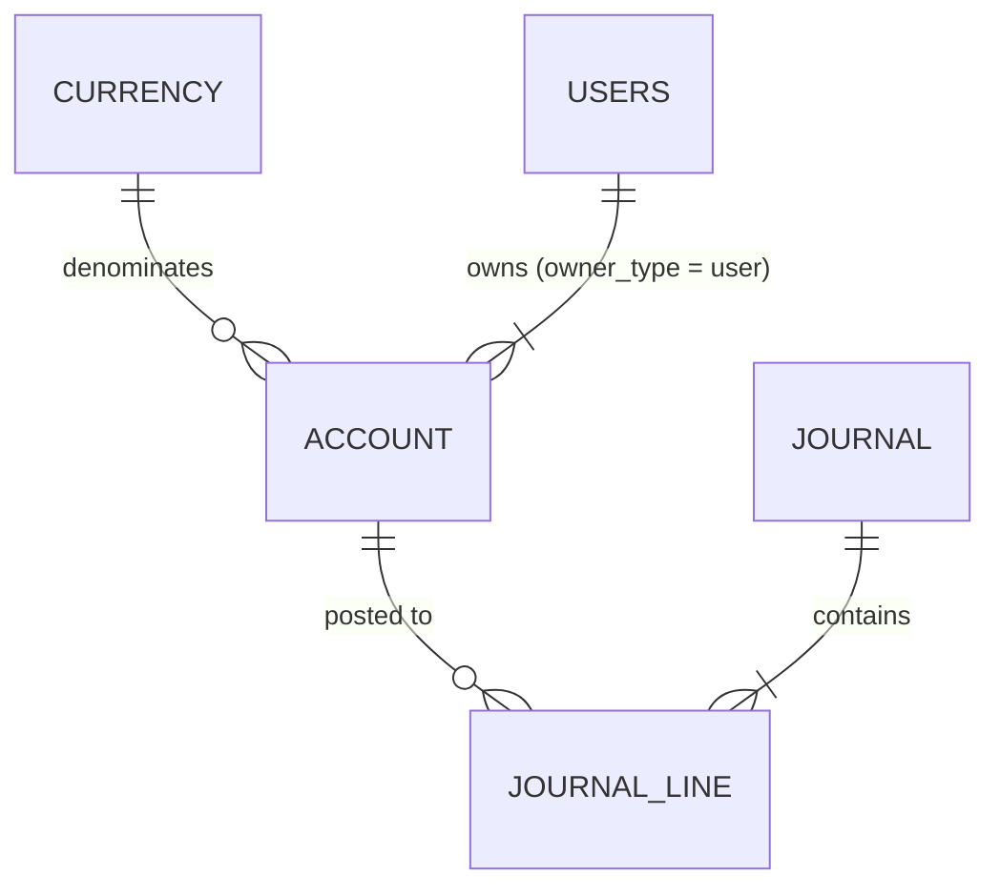

## Epic 1: Wallet foundation: sign up, sign in, see my balances

A person can create a wallet with email, password and display name (with email verification), sign in, and see USD and EUR balance cards split into available, held and pending, under the test-money banner. Seeded test users start with balances. Everything runs on local minikube through the single deploy script.

### Database design

The tables this epic introduces. Each story still writes only the migration for the tables it needs (Story 1.3 creates the empty schemas, Story 1.5 the ledger tables, Story 1.6 the identity table). Conventions: `snake_case`, singular table names (except `users`, because `user` is reserved in Postgres), UUID primary keys, `timestamptz`, and `version bigint` on every mutable row (AD-22).

| Schema.table | Columns (key ones) | Constraints and indexes | Written by |
|---|---|---|---|
| `ledger.currency` | `code char(3)` PK, `exponent smallint`, `active boolean` | Reference data in a migration: USD 2, EUR 2 | migration only |
| `ledger.account` | `id uuid` PK, `owner_type` (`user \| house \| system`), `owner_id uuid`, `currency` FK, `bucket` (`available \| held \| pending \| treasury \| cash_at_partner_bank \| opening_equity \| rounding_revenue`, extended additively by later epics), `balance bigint`, `version bigint`, `created_at` | UNIQUE `(owner_type, owner_id, currency, bucket)`; CHECK `owner_type <> 'user' OR balance >= 0`; CHECK user rows use only `available \| held \| pending` | `LedgerService` only |
| `ledger.journal` | `id uuid` PK, `type` (closed `JournalType`, starts as `seed`), `business_ref uuid`, `correlation_id`, `created_at` | UNIQUE `(type, business_ref)`; append-only | `LedgerService.post` |
| `ledger.journal_line` | `id uuid` PK, `journal_id` FK, `account_id` FK, `currency`, `amount_minor bigint` (signed), `balance_after bigint` | Index `(account_id, id)`; append-only; per-currency sum = 0 enforced in `post()` and checked by reconciliation | `LedgerService.post` |
| `identity.users` | `id uuid` PK, `cognito_sub text`, `email text`, `display_name text`, `version bigint`, `created_at`, `updated_at` | UNIQUE `cognito_sub`; UNIQUE `lower(email)`; `display_name` not blank | `identity` (`ProvisionUser`, profile update) |

**Design choice to confirm in Story 1.5:** the balance projection (AD-5 tier 3) is held as the `balance` + `version` columns on `ledger.account` (one row per account), not as a separate table. This keeps `lockAccounts` and the projection update on the same row. House/system accounts use a fixed, well-known `owner_id` per owner type, seeded by migration.

### Story 1.1: Monorepo scaffold and toolchain

As a developer,
I want a pnpm + Turborepo monorepo with the wallet's runnables and shared packages scaffolded,
So that every later story builds, lints and tests the same way from day one.

**Acceptance Criteria:**

**Given** a fresh clone
**When** I run `pnpm install && pnpm turbo build lint test`
**Then** it succeeds on Node 26 LTS with TypeScript 6.x and ESM
**And** the tree matches the spine: `apps/wallet-api` (with `src/main.ts` api and `src/worker.ts` worker entry points, NestJS 12), `apps/web` (Vite 8 + React 19.3 + React Router 8 + TanStack Query 5 + Tailwind + shadcn/ui + lucide-react), `packages/contracts` (zod v4), `packages/money` (decimal.js), `docs/partner-specs/`, `infra/{terraform,helm,scripts}`
**And** `simulators/{bank-sim, cash-sim, fx-sim, mock-jwt-issuer}` exist as NestJS 12 stubs (one placeholder route with a static dummy payload, one test), and a test import from any of them into `apps/`, `packages/` or a sibling simulator fails `pnpm lint`

**Given** the module list in AD-3
**When** I inspect `apps/wallet-api/src`
**Then** empty Nest modules exist for identity, ledger, exchange, deposits, withdrawals, transfers, notifications, history, partners and platform
**And** eslint-plugin-boundaries encodes exactly the spine's dependency graph (C4 Level 3), and a test import that violates it (e.g. `ledger` importing `exchange`, or `partners` importing `deposits`) fails `pnpm lint`
**And** across an allowed edge only `*.service.ts`, `*.module.ts` and `*.types.ts` may be imported, so a test import of another module's entity or repository (e.g. `exchange` importing `ledger/account.entity.ts`) fails `pnpm lint`

**Given** the open question on OpenAPI from zod on NestJS 12
**When** the spike runs on one sample route
**Then** a short decision note in `docs/` records whether `@nestjs/swagger` reads the Standard Schema route option or docs are assembled via `z.toJSONSchema`, and the chosen approach serves an OpenAPI document locally

### Story 1.2: API conventions: config, envelope, errors, logging and health

As a developer,
I want wallet-api's cross-cutting conventions in place before any business endpoint exists,
So that every module returns the same envelope, logs the same way and fails fast on bad config.

**Acceptance Criteria:**

**Given** wallet-api or wallet-worker starts
**When** a required environment variable is missing or invalid
**Then** the process exits at boot with a zod validation message naming the variable (AD-25)

**Given** any successful user-facing REST call
**When** the response is sent
**Then** the body is `{ "returnCode": 0, "body": ... }`, and a thrown typed domain error is turned by the single exception filter into `{ returnCode, errorMessage, body? }` with the HTTP status chosen independently (AD-21)
**And** returnCode constants and ranges (0, 1xx–9xx) and the envelope schemas live only in `packages/contracts`, and an inbound payload failing its zod schema returns a 1xx validation code via NestJS Standard Schema validation (AD-22)

**Given** an inbound request with or without a `traceparent` header
**When** it is handled
**Then** a W3C-compatible correlation id is reused or created, and every log line is structured JSON on stdout with `level`, `msg`, `correlationId`, `module`
**And** a test asserts that tokens and secrets passed through a request are not present in log output (AD-24)

**Given** a running wallet-api or wallet-worker
**When** `/healthz` and `/readyz` are called
**Then** liveness answers 200, and readiness reports the database connection
**And** on SIGTERM wallet-api stops accepting requests and exits within 30 s

### Story 1.3: Database, migrations and local cluster deploy

As a developer,
I want PostgreSQL with migrations and a one-command deploy to local minikube,
So that every later story ships the same way it will ship to dev.

**Acceptance Criteria:**

**Given** TypeORM ≥ 1.1.3 configured with `synchronize: false`
**When** I generate a migration with the TypeORM CLI
**Then** it lands in a committed migrations folder, and an initial migration creates one schema per AD-3 module

**Given** minikube pinned to Kubernetes 1.36 and Helm 4
**When** I run `infra/scripts/deploy.sh local`
**Then** it builds images, runs a migration Kubernetes Job against a PostgreSQL 18 pod, then `helm upgrade`s one chart per runnable (wallet-api, wallet-worker, web) using `values-local.yaml`
**And** wallet-worker's Deployment has `replicas: 1` and `strategy: Recreate`, and apps never migrate at startup (AD-23, AD-26)
**And** web and wallet-api are reachable through minikube ingress, with secrets from plain Kubernetes Secrets

**Given** the Testcontainers harness in `apps/wallet-api`
**When** an integration test runs
**Then** it starts real PostgreSQL 18, applies all migrations and gives the test a clean database (AD-27)

### Story 1.4: Money basics in `packages/money`

As a developer,
I want one shared way to represent, format and parse amounts,
So that no code ever does float arithmetic on money and every screen shows amounts the same way.

**Acceptance Criteria:**

**Given** an amount
**When** it is represented in TypeScript or JSON
**Then** it is `bigint` minor units in code and `{ "amountMinor": <integer>, "currency": "<ISO>" }` in JSON, with a zod schema in `packages/contracts` validating the currency against the supported set (AD-7)
**And** TypeORM column transformers map Postgres `bigint` and `numeric(18,8)` to `bigint` and `Decimal`

**Given** `formatMoney`, `parseAmountInput` and `moneyAriaLabel`
**When** they are called with currencies of exponent 2
**Then** money formats at 2 decimals in the browser locale (`$1,000.00` / `1.000,00 $`), parsing never uses `parseFloat` and rejects more decimals than the currency's exponent, and the aria label reads the currency name ("one thousand US dollars")
**And** a lint rule or test fails on arithmetic using JS `number` over amount types in `packages/money`

### Story 1.5: Ledger core: accounts, journals and balance projection

As the house,
I want every balance change recorded as a balanced, append-only journal,
So that money is always accounted for and drift can be detected (NFR-1).

**Acceptance Criteria:**

**Given** the ledger migrations
**When** they run
**Then** `ledger.currencies` holds USD and EUR (ISO code + exponent 2), and `account` rows exist per `(owner_type, owner_id, currency, bucket)` for house/system positions: treasury, cash at partner bank, opening equity and rounding/fee revenue per currency (AD-6)
**And** user accounts have a DB `CHECK (balance >= 0)`, and every account and projection row has `version bigint`

**Given** `LedgerService.lockAccounts(tx, ids)`
**When** it is called
**Then** it locks all listed accounts `FOR UPDATE` in a single statement ordered by id (AD-14)

**Given** `LedgerService.post(tx, journal)` with a `JournalType` from the closed enum (initially `seed`)
**When** the lines per currency sum to zero and all accounts are locked
**Then** one `journal` row unique on `(type, business_ref)` and its `journal_line`s (account, signed amount, `balance_after`) are written, the projection is updated with `version + 1`, all in the caller's transaction
**And** posting the same `(type, business_ref)` twice fails on the unique constraint
**And** a journal whose lines don't sum to zero per currency is refused
**And** `post()` on an account not locked in this transaction is refused (Testcontainers test, AD-27)
**And** a user account posting that would go below zero fails on the CHECK and rolls back the whole journal

### Story 1.6: Sign-in tokens, the JWT guard and user provisioning

As a person signing up,
I want my wallet created the moment my account exists,
So that I start with a USD and an EUR balance at zero (FR-1).

**Acceptance Criteria:**

**Given** `simulators/mock-jwt-issuer` running locally
**When** it issues a token
**Then** the token has Cognito access-token claims (`sub`, `iss`, `token_use=access`, `client_id`, `cognito:groups`), is signed with a key published at a JWKS endpoint, and is deployed by the deploy script as a local-only chart

**Given** any wallet-api user route
**When** a request arrives without a token, with a bad signature, a wrong `iss`, `token_use` ≠ `access`, or a wrong `client_id`
**Then** it is refused with HTTP 401 and a 1xx returnCode, by the same guard in every environment, with no bypass flag (AD-20)

**Given** a signed-in person with no wallet yet
**When** the client calls `POST /me` with a display name
**Then** `identity` inserts the user (email unique, display name, Cognito `sub` → `user_id`) with `ON CONFLICT (cognito_sub) DO NOTHING`, and only when its insert won it creates available, held and pending accounts at zero for every supported currency in the same transaction
**And** two concurrent `POST /me` calls for the same `sub` create exactly one user and one set of accounts
**And** a missing or blank display name is refused with a 2xx returnCode

**Given** a provisioned user
**When** they call `GET /me`
**Then** they receive their user id, email and display name, and no other module reads `sub`

### Story 1.7: Web app shell and design system

As a user,
I want a friendly, phone-first app shell that always tells me the money is test money,
So that every screen feels consistent and I'm never misled about real value.

**Acceptance Criteria:**

**Given** the DESIGN.md frontmatter
**When** the web app builds
**Then** every colour token exists as a shadcn/Tailwind CSS variable for light and dark (dark resolves `x` to `x-dark`), Inter and JetBrains Mono are loaded, tabular numerals apply to amounts, and the radius and spacing tokens are configured (UX-DR1–UX-DR3)
**And** theme follows a device-local `localStorage` preference with a safe default when storage is unavailable

**Given** any screen, including sign-in
**When** it renders
**Then** the amber "Test money — no real value" banner is pinned at the very top inside the `banner` landmark (UX-DR5)

**Given** a phone-width viewport (< 1024 px)
**When** a signed-in user navigates
**Then** a bottom tab bar shows Home · Exchange · Activity · Account, a header holds a notifications bell placeholder, and touch targets are at least 44 px
**And** at ≥ 1024 px a left sidebar replaces the tab bar, and between 768 and 1023 px content is centred at 560 px (UX-DR7, UX-DR39)

**Given** the shared primitives
**When** used
**Then** the primary button is 48 px tall, md radius and full-width sticky footer on phones, inline on desktop (UX-DR8)
**And** the Copy affordance copies the ungrouped value and shows "Copied" for 1.5 s (UX-DR27)
**And** list surfaces cold-load with skeleton rows, focus rings are always visible, Esc closes the topmost sheet, and `prefers-reduced-motion` is respected (UX-DR35, UX-DR36, UX-DR38)
**And** a returnCode → copy table exists in `apps/web` as the only place error copy comes from (UX-DR37)

### Story 1.8: Sign up, verify email, sign in and sign out

As a person,
I want to create a wallet with my email, password and display name and sign in to it,
So that I have my own USD and EUR wallet (FR-1).

**Acceptance Criteria:**

**Given** the web auth adapter selected by config (mock issuer locally; Amplify Auth v6 against Cognito implemented behind the same interface)
**When** I submit the sign-up form with email, password and a required display name
**Then** I'm taken to a verify-email code screen, and after entering the code the client calls `POST /me` with my display name and lands me on Home
**And** the verify-email screen follows the UX layout of the other auth forms, flagged as the open UX handoff for final copy

**Given** an email already registered
**When** I sign up
**Then** I see "There's already a wallet with this email. Sign in instead?" (UX-DR34)

**Given** the sign-in form
**When** the email or password is wrong
**Then** I see "That email and password don't match." without saying which one

**Given** a signed-in session
**When** the access token expires and can't be refreshed
**Then** I return to Sign in, and after signing in I land on the same surface
**And** a 401 on an API call triggers one token refresh and resend before falling back to Sign in

**Given** I'm signed in
**When** I choose Sign out in Account
**Then** tokens are cleared and I'm on Sign in

### Story 1.9: See my balances on Home

As a user,
I want to see my USD and EUR balances split into available, held and pending,
So that I always know where my money is (FR-2, JTBD-3).

**Acceptance Criteria:**

**Given** a signed-in user
**When** the client calls `GET /me/balances`
**Then** the response lists, per supported currency, available, held and pending as `{amountMinor, currency}` with each projection's `version`, and never includes house or system accounts (AD-6)

**Given** Home
**When** it loads
**Then** there is one balance card per currency with flag and code, available in `amount-display`, and separate **Held** and **Pending** footer buttons at least 44 px tall, shown even at zero (UX-DR12)
**And** amounts are formatted only through `formatMoney`, read with their currency by screen readers, and never coloured green or red (UX-DR4)
**And** at ≥ 1024 px the cards sit side by side

**Given** a new wallet with zero balances
**When** Home renders
**Then** both cards show 0.00 and the message "Add money to get started" (the Add money link is wired in Epic 5)

### Story 1.10: Account and profile

As a user,
I want to change my display name and theme,
So that friends recognise me when they send money and the app looks the way I like (FR-1).

**Acceptance Criteria:**

**Given** the Account tab
**When** it opens
**Then** it shows Profile (display name, email), Theme (light / dark / system) and Sign out

**Given** Profile
**When** I save a new non-blank display name
**Then** `POST /me` updates it, and `GET /me` returns the new name
**And** a blank name is refused inline and nothing is saved

**Given** Theme
**When** I pick light, dark or system
**Then** the app switches immediately (optimistic, preferences only) and remembers the choice on this device

### Story 1.11: Seeded test users and the reconciliation job

As a pilot tester,
I want test users that already hold USD and EUR, and a job that proves the books balance,
So that I can exercise exchanges before deposits exist and trust the ledger (SM-2).

**Acceptance Criteria:**

**Given** the idempotent seed Kubernetes Job (local and dev only)
**When** the deploy script runs it, once or many times
**Then** test users exist mapped to known mock-jwt-issuer `sub`s locally (and to existing Cognito `sub`s in dev, configured outside git), the house treasury holds USD and EUR, and every seeded amount was posted through `LedgerService.post` as `seed` journals against opening equity (AD-23)
**And** running it twice creates no duplicate users or journals

**Given** wallet-worker running
**When** the reconciliation job runs on its schedule
**Then** in a `REPEATABLE READ READ ONLY` transaction it checks that journal lines sum to zero per currency and that every projection equals the sum of its account's lines, and writes one structured result log line (ok, or the mismatching accounts) (AD-15, AD-19)
**And** a Testcontainers test that corrupts a projection row makes the job report that account
